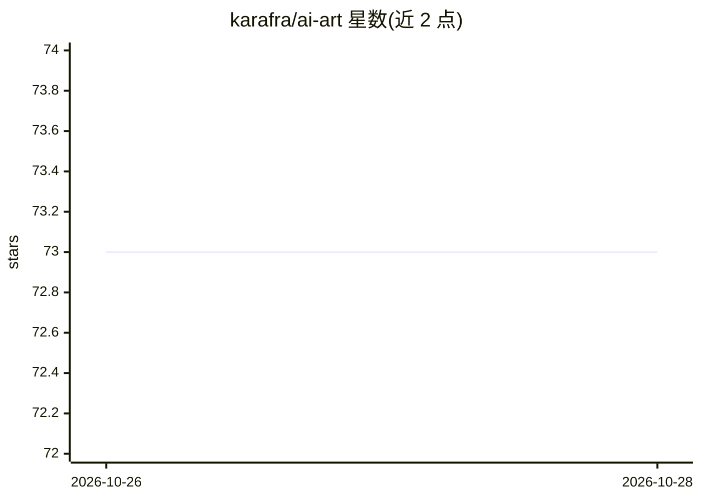

# karafra/ai-art

⭐ 73 · TypeScript · Apache-2.0 · 推送 2026-10-25 · [GitHub](https://github.com/karafra/ai-art) · [官网](https://karafra.github.io/ai-art/) · 个人维护

**Discord 机器人：按查询生成 AI 图像拼贴**

基于 TypeScript/Discord.js/NestJS 的 Discord 机器人，用户通过斜杠命令输入查询，调用 CogView2、Dall-e mini、WomboDream 模型生成 9 图拼贴或单图，另有基于 OpenAI API 的标题生成故事命令；对拼贴回应信封表情可将图片私信发送。技术栈含 RabbitMQ（amqp-client）、MongoDB、TypeORM、GraphQL、Sentry、Jest，提供 Heroku 一键部署与 docker-compose 容器化部署两种方式，需在 config.yml 或环境变量中配置 Discord token。

## 筛选速览

| 维度 | 判定 | 备注 |
|---|---|---|
| AI 角色 | `ai-native` | 本体是模型或模型工具 |
| 许可风险 | `permissive` | Apache-2.0 |
| 部署形态 | `library` | 以包/库形式分发 |
| 模型依赖 | — | README 未给出锁定关系 |
| 硬件要求 | — | 无带数字的原话,不猜 |
| 安装摩擦 | `low` | 无编译、无系统依赖或容器化 |
| 成熟度 | — | 结构信号不足 |

## 能力要点

- 三种图像生成模型：CogView2、Dall-e mini、WomboDream
- 生成 9 图拼贴，可经表情反应私信获取
- /ai-story 命令按标题生成故事（需 OpenAI API token）
- 提供 Heroku 一键部署与 docker-compose 容器化部署

## 适用场景

- 在 Discord 服务器内用斜杠命令生成 AI 图像拼贴
- 用标题让机器人生成故事
- 通过 Heroku 或 Docker 快速自部署该机器人

## 场景标签

`图像生成` `AI 写作` · 领域:内容生成

## 证据(README 行号)

> L17:  Discord bot generating AI art collages
> L158:  - `cog-view-2` - Generates collage of 9 images using CogView2 model
> L159:  - `dalle-mini` - Generates collage of 9 images using Dall-e mini model
> L160:  - `wombo-dream` - Generartes one image based on WomboDream model

## 星数曲线

2026-10-26 73 → 2026-10-28 73（+0）

---
*卡片 v1 · prompt 1.4 · 生成 2026-10-27 · 置信度 high · 依据 README sha `1c5906df79ef` · [字段定义](../../DATASET.md)*
