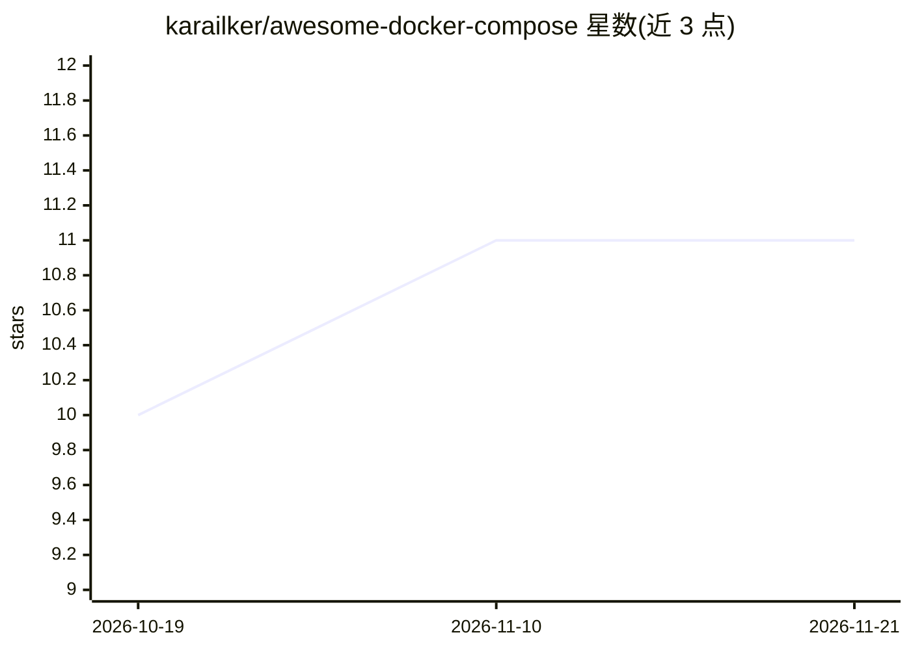

# karailker/awesome-docker-compose

⭐ 11 · Shell · MIT · 推送 2026-11-17 · [GitHub](https://github.com/karailker/awesome-docker-compose) · 个人维护

**面向开发者的常用服务 Docker Compose 配置集合**

收录多种常用服务的 Docker Compose 配置，分为 base（Postgres、Kafka、Redis、RabbitMQ、MinIO、向量数据库、Elasticsearch、Grafana 等 27 个单服务配置）与 stacks（MLflow、数据平台、Langfuse、本地 RAG/LLM 等组合栈）两类。每个配置自包含，通过 .env 文件配置，数据存于命名 Docker 卷，可选组件置于 Compose profiles 后；README 给出 make 快捷命令并声明 CI 覆盖 lint、compose config 校验、容器冒烟测试与安全检查。要求 Docker Compose v2，凭据仅供本地开发。

## 筛选速览

| 维度 | 判定 | 备注 |
|---|---|---|
| AI 角色 | `ai-knowledge` | 知识聚合/清单类 |
| 许可风险 | `permissive` | MIT |
| 部署形态 | `self-host` | docker 或自建部署 |
| 模型依赖 | local-ok | 支持本地模型 |
| 硬件要求 | — | 无带数字的原话,不猜 |
| 安装摩擦 | `low` | 无编译、无系统依赖或容器化 |
| 成熟度 | — | 结构信号不足 |

## 能力要点

- 27 个单服务配置与 8 个多服务组合栈（L10-L36、L42-L49）
- 每个配置自包含，.env 配置 + 命名卷存储 + profiles 可选组件
- make up/smoke/check/secrets 快捷命令
- CI 包含 YAML lint、镜像可用性检查、冒烟测试、gitleaks/Trivy 安全扫描

## 适用场景

- 本地开发时快速起一套数据库/消息队列/监控环境
- 用 stacks 一键部署 MLflow、数据平台或本地 RAG 私有问答栈
- 作为项目基础设施配置的搭建模块复用

## 场景标签

 · 领域:开发运维/基础设施配置集合

## 证据(README 行号)

> L3: This repository contains a collection of Docker Compose configurations for various services.
> L5: ## Available Configurations
> L72: Every configuration is self-contained. Pick a directory, create your `.env`, and start it:

## 星数曲线

2026-10-19 10 → 2026-11-21 11（+1）

---
*卡片 v1 · prompt 1.4 · 生成 2026-11-18 · 置信度 high · 依据 README sha `9365c889ff58` · [字段定义](../../DATASET.md)*
