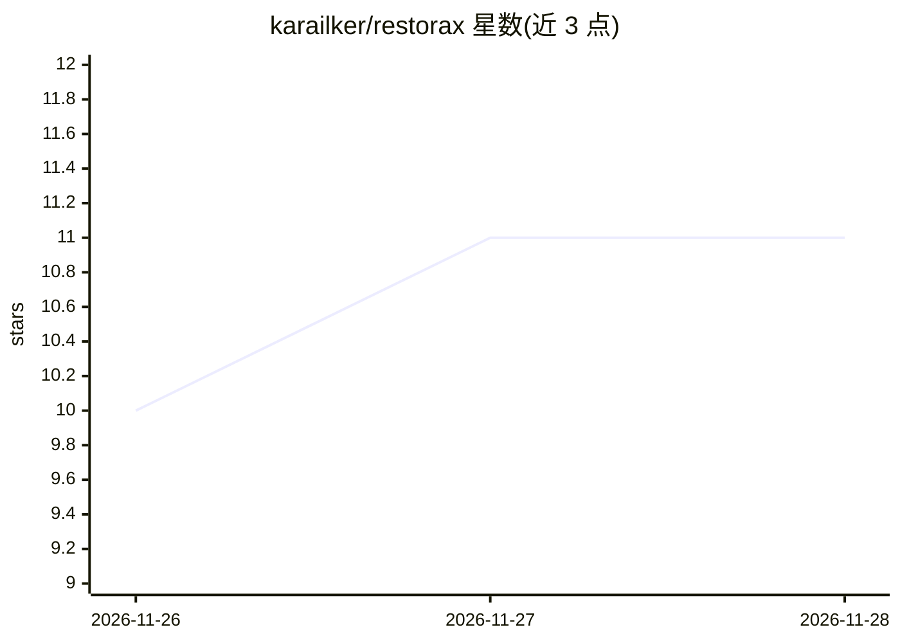

# karailker/restorax

⭐ 11 · Python · MIT · 推送 2026-11-27 · [GitHub](https://github.com/karailker/restorax) · [官网](https://karailker.github.io/restorax) · 个人维护

**开源 AI 视频/音频修复平台：老片与档案影像的复原管线**

将 25 个修复模型（README 声明其中 11 个可直接运行、4 个经经典算法回退）组合为模块化修复管线，任务覆盖超分辨率、上色、人脸修复、插帧、去划痕、反交错、防抖、SDR→HDR 与音频降噪，并提供 Pipeline DAG 引擎（类型化端口、并行分支、重试策略）、React Flow 可视化节点编排器、REST API 与 CLI。技术栈为 FastAPI + Celery + Redis + Vite/React，权重首次使用时自动从 HuggingFace Hub 下载。提供 Docker Compose 部署路径；CPU 可运行，推荐 GPU 8GB+ VRAM。

## 筛选速览

| 维度 | 判定 | 备注 |
|---|---|---|
| AI 角色 | `ai-native` | 本体是模型或模型工具 |
| 许可风险 | `permissive` | MIT |
| 部署形态 | `desktop` | 安装包/桌面程序 |
| 模型依赖 | — | README 未给出锁定关系 |
| 硬件要求 | `gpu-8g` | |
| 安装摩擦 | `low` | 无编译、无系统依赖或容器化 |
| 成熟度 | — | 结构信号不足 |

## 能力要点

- 25 个修复模型覆盖视频与音频两类修复任务
- Pipeline DAG 引擎与 React Flow 可视化节点编排
- REST API、CLI 与 ComfyUI 节点包三种使用入口
- 插件系统支持第三方 restorer（pip install restorax-plugin-*）

## 适用场景

- 修复老电影、家庭录像与档案影像（去噪、上色、超分、反交错）
- 搭建自托管的视频修复服务并通过 REST API 调用
- 用可视化画布编排多阶段修复分支流程
- 批量处理 VHS 录像带或旧新闻片的多任务修复管线

## 场景标签

`图像视频处理` · 领域:感知与多模态

## 证据(README 行号)

> L3: **Open-source AI video restoration toolkit for old films, home videos, and archival footage.**
> L10: RestoraX combines 25 restoration models (11 fully work today, 4 more run through classical fallbacks — see Model st
> L59: |`api`|<http://localhost:8000>|FastAPI — REST API + WebSocket progress|

## 星数曲线

2026-11-26 10 → 2026-11-28 11（+1）

---
*卡片 v1 · prompt 1.4 · 生成 2026-11-26 · 置信度 high · 依据 README sha `f512414f33f2` · [字段定义](../../DATASET.md)*
