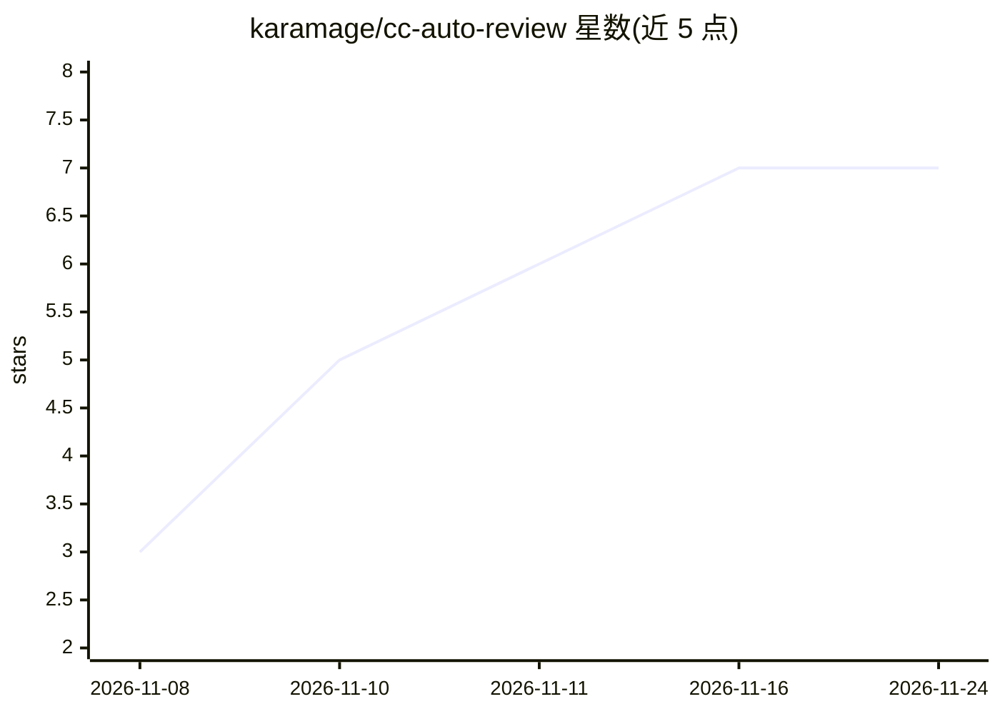

# karamage/cc-auto-review

⭐ 7 · TypeScript · MIT · 推送 2026-11-13 · [GitHub](https://github.com/karamage/cc-auto-review) · [官网](https://karamage.github.io/cc-auto-review/) · 个人维护

**用本地 Claude Code 审查 GitHub PR 的 macOS/Linux 桌面应用**

桌面应用（Tauri 2，macOS 与 Linux）调用本机已安装的 Claude Code（claude -p）对 GitHub PR 运行 AI 审查：diff 与发现并排展示，用户逐条接受/拒绝/编辑后再发布到 GitHub，并输出 0–100 风险评分（确定性基线 + AI ±20 调整）。可选 autopilot 自动审查请求列表，仅将高风险 PR（CI、迁移、密钥、大 diff、高分）转交人工。不存储 Claude 凭据，GitHub 访问走 gh 登录；不克隆仓库，仅拉取变更文件到临时目录。前置条件：gh 与 Claude Code 2.1.314+。

## 筛选速览

| 维度 | 判定 | 备注 |
|---|---|---|
| AI 角色 | `ai-native` | 本体是模型或模型工具 |
| 许可风险 | `permissive` | MIT |
| 部署形态 | `desktop` | 安装包/桌面程序 |
| 模型依赖 | — | README 未给出锁定关系 |
| 硬件要求 | — | 无带数字的原话,不猜 |
| 安装摩擦 | `low` | 无编译、无系统依赖或容器化 |
| 成熟度 | — | 结构信号不足 |

## 能力要点

- diff 与 AI 发现并排显示，逐条接受/拒绝/编辑后发布
- 0–100 风险评分：diff 确定性基线 + 上限 ±20 的 AI 调整
- autopilot 自动审查，仅高风险 PR 转交人工
- 审查 profile 可定制（视角、指南、Skills/MCP 工具）与 Learnings 跨审查传承

## 适用场景

- PR 审查积压时先让 AI 初审，只人工处理高风险 PR
- 无需管理员权限即可对 gh 可读的任意仓库运行 AI 审查
- 安全/代码规范等不同审查视角按仓库或标签路由

## 场景标签

`代码审查` · 领域:编码与开发

## 证据(README 行号)

> L9:  It reviews GitHub pull requests on macOS and Linux with your local <code>claude -p</code>: AI findings next to the 
> L44: **CC Auto Review** puts a pull request's diff and Claude's findings on one screen. You accept, reject, or edit each
> L118: - macOS 11+, or Linux x86_64 with WebKitGTK 4.1

## 星数曲线

2026-11-08 3 → 2026-11-24 7（+4）

---
*卡片 v1 · prompt 1.4 · 生成 2026-11-20 · 置信度 high · 依据 README sha `8548609d1f84` · [字段定义](../../DATASET.md)*
