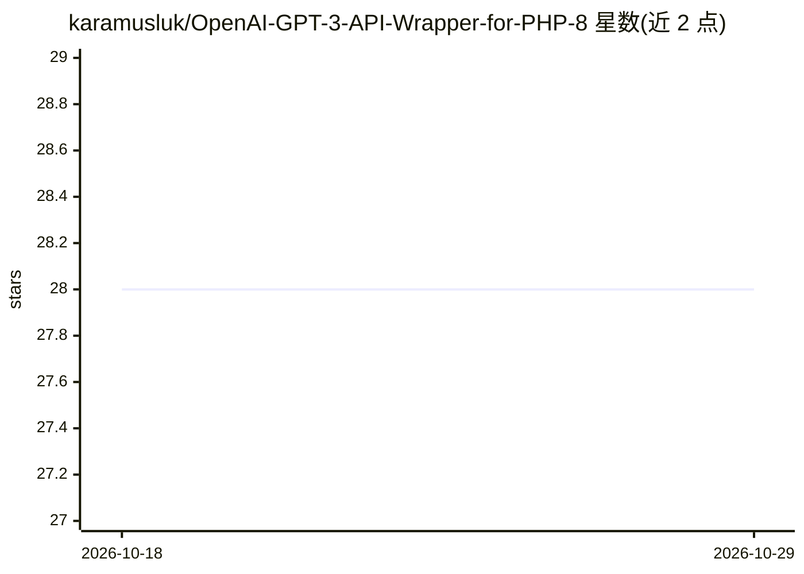

# karamusluk/OpenAI-GPT-3-API-Wrapper-for-PHP-8

⭐ 28 · PHP · MIT · 推送 2026-10-04 · [GitHub](https://github.com/karamusluk/OpenAI-GPT-3-API-Wrapper-for-PHP-8) · 个人维护

**PHP 8 调用 OpenAI GPT-3 API 的封装库**

面向 PHP 8 开发者的 OpenAI GPT-3 API 封装库：以类实例方式初始化，通过构造函数传入 API key（secretKey 或位置参数），可指定默认引擎（如 ada）。README 提供示例代码并附多个示例文件，需用户自备 OpenAI API key。仓库极简，仅含用法示例与要求说明。

## 筛选速览

| 维度 | 判定 | 备注 |
|---|---|---|
| AI 角色 | `ai-ecosystem` | LLM/agent 周边工具 |
| 许可风险 | `permissive` | MIT |
| 部署形态 | `None` |  |
| 模型依赖 | — | README 未给出锁定关系 |
| 硬件要求 | — | 无带数字的原话,不猜 |
| 安装摩擦 | `low` | 无编译、无系统依赖或容器化 |
| 成熟度 | — | 结构信号不足 |

## 能力要点

- 以 PHP 8 类封装 OpenAI GPT-3 API 调用
- 构造函数支持命名参数传入 secretKey 与 defaultEngine
- 提供多个示例代码文件

## 适用场景

- 在 PHP 8 项目中调用 OpenAI GPT-3 API
- 指定引擎（如 ada）生成文本

## 场景标签

 · 领域:LLM API 客户端

## 证据(README 行号)

> L4: PHP 8 Wrapper for OpenAI GPT-3 API.
> L18: You need to give Open AI API key to the contructor as follows;

## 星数曲线

2026-10-18 28 → 2026-10-29 28（+0）

---
*卡片 v1 · prompt 1.4 · 生成 2026-10-26 · 置信度 high · 依据 README sha `2d28f17438c7` · [字段定义](../../DATASET.md)*
