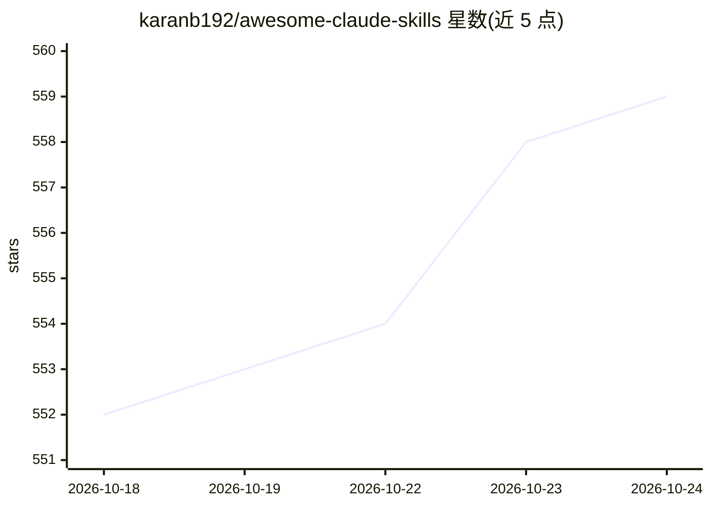

# karanb192/awesome-claude-skills

⭐ 561 · MIT · 推送 2026-10-02 · [GitHub](https://github.com/karanb192/awesome-claude-skills) · 个人维护 · 中文 README

**社区维护的 Claude 技能（Skills）目录清单，按任务分类**

面向 Claude Code、Claude.ai 和 API 用户的技能（agent skills）社区目录：条目按文档文件处理、测试、调试、协作流程、开发架构、安全性能等类别组织，每个技能名链接到其源仓库，安装指南需到来源处阅读。清单声明收录不代表安全审计，并提示用 Ctrl+F 检索。给希望在 Claude 环境中为 PDF 处理、TDD、git 工作流、安全审计等任务查找现成技能的开发者使用。

## 筛选速览

| 维度 | 判定 | 备注 |
|---|---|---|
| AI 角色 | `ai-knowledge` | 知识聚合/清单类 |
| 许可风险 | `permissive` | MIT |
| 部署形态 | `None` |  |
| 模型依赖 | — | README 未给出锁定关系 |
| 硬件要求 | — | 无带数字的原话,不猜 |
| 安装摩擦 | `medium` | 含编译或系统依赖之一 |
| 成熟度 | — | 结构信号不足 |

## 能力要点

- 按 6 大类组织 50+ 条技能条目，技能名链接到源仓库
- 提供'任务→技能'的起步建议表（PDF 提取、TDD、调试等）
- 声明收录不构成安全审计，安装指引在来源仓库

## 适用场景

- 为 Claude Code / Claude.ai 查找处理 PDF、Word、PPT 等文件的技能
- 查找测试、调试、代码评审类工作流技能
- 浏览安全审计与性能检查类技能条目

## 场景标签

`精选清单` · 领域:学习与行业

## 证据(README 行号)

> L3: Find a skill for the task at hand. A community directory for
> L4: Claude Code,
> L20: ## Browse skills

## 星数曲线

2026-10-18 552 → 2026-10-24 559（+7）

---
*卡片 v1 · prompt 1.4 · 生成 2026-10-21 · 置信度 high · 依据 README sha `7cb11eb1b1d6` · [字段定义](../../DATASET.md)*
