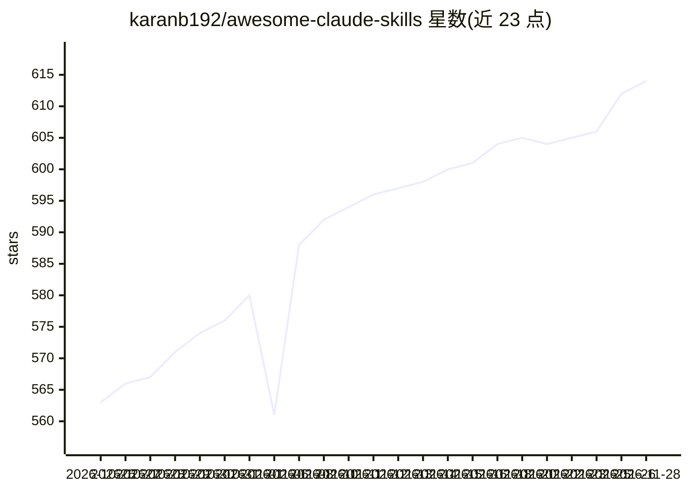

# karanb192/awesome-claude-skills

⭐ 614 · MIT · 推送 2026-11-25 · [GitHub](https://github.com/karanb192/awesome-claude-skills) · 个人维护

**面向 Claude 用户的社区技能目录：按任务查找可用技能**

一个社区维护的 Claude Skills 目录清单，收录 50 余条经整理的技能条目，服务对象是 Claude Code、Claude.ai 及 API 的使用者。条目按文档处理、测试与质量、调试、协作工作流、开发与架构等类别组织，每条给出用途一句话说明并链接到技能源仓库。README 提醒使用者阅读源仓库的安装指南，并声明收录不代表经过安全审计；检索方式为浏览器内查找。

## 筛选速览

| 维度 | 判定 | 备注 |
|---|---|---|
| AI 角色 | `ai-knowledge` | 知识聚合/清单类 |
| 许可风险 | `permissive` | MIT |
| 部署形态 | `None` |  |
| 模型依赖 | — | README 未给出锁定关系 |
| 硬件要求 | — | 无带数字的原话,不猜 |
| 安装摩擦 | `medium` | 含编译或系统依赖之一 |
| 成熟度 | — | 结构信号不足 |

## 能力要点

- 50+ 条技能条目按任务场景分类组织
- 覆盖文档处理、TDD、调试、git 工作流等开发环节
- 每条条目链接到技能源仓库并附用途说明
- README 声明收录不构成安全审计

## 适用场景

- 想给 Claude Code 找一个 PDF 表格提取或调试类技能
- 为团队整理可复用的 Claude 技能清单
- 开发自己的 skill 前参考社区条目写法

## 场景标签

`精选清单` · 领域:学习与行业

## 证据(README 行号)

> L3: Find a skill for the task at hand. A community directory for
> L29: Skill names link to their source. Read the install guide there before enabling

## 星数曲线

2026-10-26 563 → 2026-11-28 614（+51）

---
*卡片 v1 · prompt 1.4 · 生成 2026-11-25 · 置信度 high · 依据 README sha `affac2b9cc3a` · [字段定义](../../DATASET.md)*
