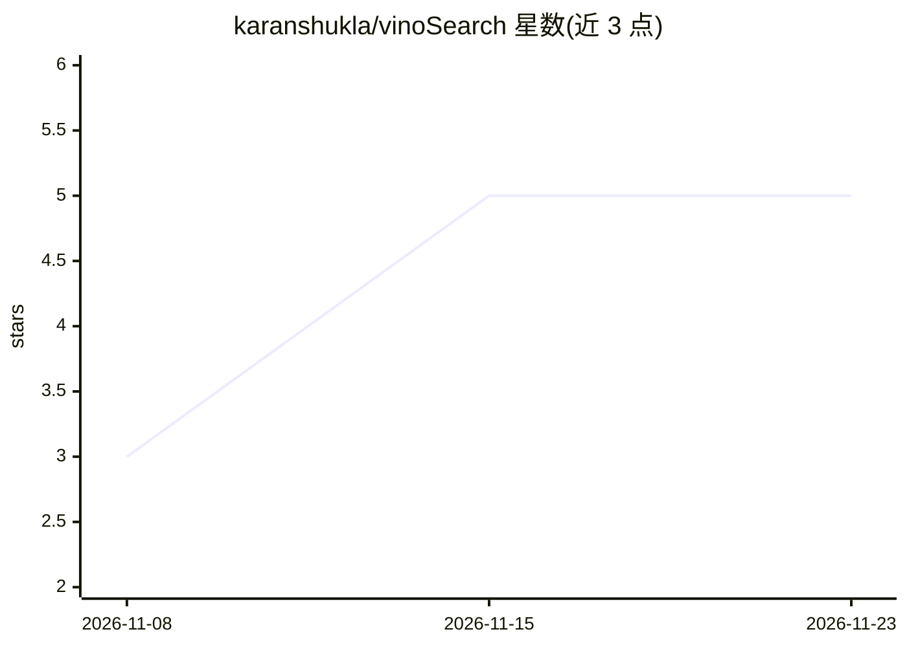

# karanshukla/vinoSearch

⭐ 5 · Rust · MIT · 推送 2026-11-22 · [GitHub](https://github.com/karanshukla/vinoSearch) · [官网](https://vinosearch.vinopilot.ca/) · 个人维护

**Linux 本地文件语义搜索工具，用 Intel NPU 加速索引与查询**

在 KRunner、GNOME Shell 概览搜索及 CLI/dmenu 启动器中按内容而非文件名检索本地文件：默认索引 Markdown 与纯文本，可选支持照片、文档、音视频、源码；索引通过 inotify 秒级增量更新，嵌入模型（EmbeddingGemma 2、PP-OCRv6）经 OpenVINO 运行于 Intel NPU，无 NPU 时回退 CPU。全本地运行，索引存 SQLite，可选 SQLCipher+TPM 加密；要求 Core Ultra 及以上硬件与 Wayland 桌面，x86_64 预编译包需 glibc 2.39+。

## 筛选速览

| 维度 | 判定 | 备注 |
|---|---|---|
| AI 角色 | `ai-native` | 本体是模型或模型工具 |
| 许可风险 | `permissive` | MIT |
| 部署形态 | `None` |  |
| 模型依赖 | — | README 未给出锁定关系 |
| 硬件要求 | — | 无带数字的原话,不猜 |
| 安装摩擦 | `low` | 无编译、无系统依赖或容器化 |
| 成熟度 | — | 结构信号不足 |

## 能力要点

- NPU 加速索引（~28.6 chunks/s、单核 CPU 占用 ~3%），热查询 p50 26 ms
- 文本、文档、代码、图片统一入口，`code:` 前缀单独搜代码
- 跳转到匹配位置：文本行、PDF 页、音视频时间戳
- SHA-256 校验模型文件，索引 0600/0700 权限并可 SQLCipher 加密

## 适用场景

- 在桌面搜索框里用自然语言找记不清文件名的笔记和文档
- 按图片内容描述查找照片库中的照片
- 在 Sway/Hyprland 等窗口管理器里用快捷键唤起语义搜索

## 场景标签

`语义搜索` · 领域:知识与检索

## 证据(README 行号)

> L9: vinoSearch finds files by their contents rather than just their filenames. You can locate `signing-keys.md` by askin
> L12: - **Intel NPU acceleration.** Indexing runs on the NPU at ~28.6 chunks/s while using only ~3% of one CPU core. Warm
> L15: - **Local and private.** Everything runs locally; the only network requests download the OpenVINO runtime and model

## 星数曲线

2026-11-08 3 → 2026-11-23 5（+2）

---
*卡片 v1 · prompt 1.4 · 生成 2026-11-21 · 置信度 high · 依据 README sha `450550c62cf9` · [字段定义](../../DATASET.md)*
