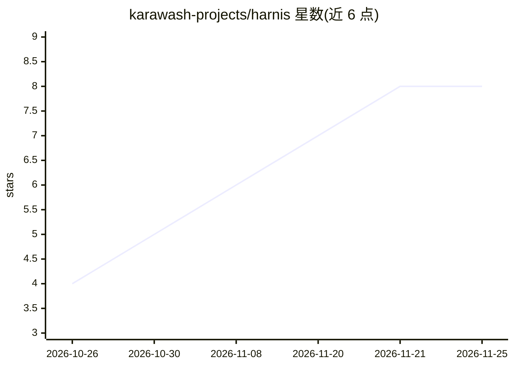

# karawash-projects/harnis

⭐ 8 · Python · Apache-2.0 · 推送 2026-11-22 · [GitHub](https://github.com/karawash-projects/harnis) · [官网](https://karawash-projects.github.io/harnis/) · 组织维护

**企业内安全运行 AI agent 的自托管平台**

自托管的 AI agent 运行平台：同一引擎提供三种工作负载——每次改动需人工审批的 CLI 编码 agent、可互相移交的专家 agent 工作流、带流式事件与审批控制台的多租户 Web 应用。安全机制包括数据库层租户隔离、高风险工具调用挂起等待审批、不可信代码的一次性沙箱容器（支持 gVisor）、每轮预算与循环断路器、追加式审计日志。自带 mock provider 可在无 API key 的情况下体验全部流程。

## 筛选速览

| 维度 | 判定 | 备注 |
|---|---|---|
| AI 角色 | `ai-ecosystem` | LLM/agent 周边工具 |
| 许可风险 | `permissive` | Apache-2.0 |
| 部署形态 | `self-host` | docker 或自建部署 |
| 模型依赖 | local-ok | 支持本地模型 |
| 硬件要求 | — | 无带数字的原话,不猜 |
| 安装摩擦 | `low` | 无编译、无系统依赖或容器化 |
| 成熟度 | — | 结构信号不足 |

## 能力要点

- 高风险工具调用挂起会话，审批绑定动作的 SHA-256，含职责分离与过期
- 租户隔离基于强制启用的 Postgres 行级安全，租户取自验证后的 token
- 每条命令在一次性容器/Pod 中运行：无网络、只读根、能力全删、支持 gVisor
- 自带 mock provider 与本地 Keycloak 测试环境，无 API key 可体验全部路径

## 适用场景

- 企业内部署编码 agent，文件改动经人工审批后落盘
- 多客户场景下隔离各租户的数据与模型调用范围
- 为 agent 操作留审计证据供合规审查

## 场景标签

`Agent 框架` `多智能体` · 领域:Agent 开发

## 证据(README 行号)

> L5: **An open-source, self-hosted platform for running AI agents safely inside a company.**
> L7: Harnis gives your teams one place to run agents that read and change real things (code, files, tickets, internal sys
> L15: Bring your own models (Anthropic, OpenAI, Google Gemini, Amazon Nova on Bedrock, or anything with an OpenAI-compati

## 星数曲线

2026-10-26 4 → 2026-11-25 8（+4）

---
*卡片 v1 · prompt 1.4 · 生成 2026-11-20 · 置信度 mid · 依据 README sha `1b87b3540f95` · [字段定义](../../DATASET.md)*
