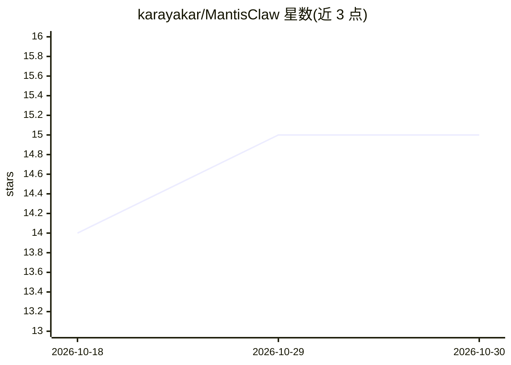

# karayakar/MantisClaw

⭐ 15 · Go · MPL-2.0 · 推送 2026-07-03 · [GitHub](https://github.com/karayakar/MantisClaw) · [官网](https://mantisclaw.yapzek.ai) · 个人维护

**桌面端计算机使用代理（CUA），通过聊天渠道指挥自动化**

面向团队的桌面自主代理应用：用户从 WhatsApp、Telegram、Slack 或内置聊天发出指令，代理在真实桌面与浏览器环境执行点击、登录、截图、查邮件等操作，并返回结果。支持多代理编排、技能自写自调试（自愈）、MCP 工具发现、OpenAI 兼容工具调用、内置 Office 引擎（Word/Excel/PowerPoint/PDF）与本地数据库存储密钥。跨 Windows/Linux/macOS 提供下载即用的桌面程序，Workflow、节点注册表与模板功能标注为开发中 POC。

## 筛选速览

| 维度 | 判定 | 备注 |
|---|---|---|
| AI 角色 | `ai-native` | 本体是模型或模型工具 |
| 许可风险 | `permissive` | MPL-2.0 |
| 部署形态 | `None` |  |
| 模型依赖 | — | README 未给出锁定关系 |
| 硬件要求 | — | 无带数字的原话,不猜 |
| 安装摩擦 | `low` | 无编译、无系统依赖或容器化 |
| 成熟度 | `idea` | |

## 能力要点

- 通过 WhatsApp/Telegram/Slack 等聊天渠道指挥桌面与浏览器自动化任务
- 技能自写、自调试、自执行的自愈机制
- 内置 Office 引擎处理 Word/Excel/PowerPoint/PDF，无需外部应用
- 密钥本地存储并运行时注入，不发送给 LLM

## 适用场景

- 团队成员在聊天里发指令让代理在桌面完成实际操作
- 跨消息渠道管理并监督多个自主代理的执行
- 需要本地优先数据与密钥控制的办公自动化

## 场景标签

`GUI 自动化` `浏览器自动化` `AI 助手` · 领域:效率与自动化

## 证据(README 行号)

> L1: 🦗 MantisClaw - Desktop CUA (Computer Use Agent)
> L30: MantisClaw integrates autonomous agents across multiple channels so your team can command, automate, and supervise 
> L76: - Run autonomous tasks on real desktop environments

## 星数曲线

2026-10-18 14 → 2026-10-30 15（+1）

---
*卡片 v1 · prompt 1.4 · 生成 2026-10-30 · 置信度 mid · 依据 README sha `ea857b7026af` · [字段定义](../../DATASET.md)*
