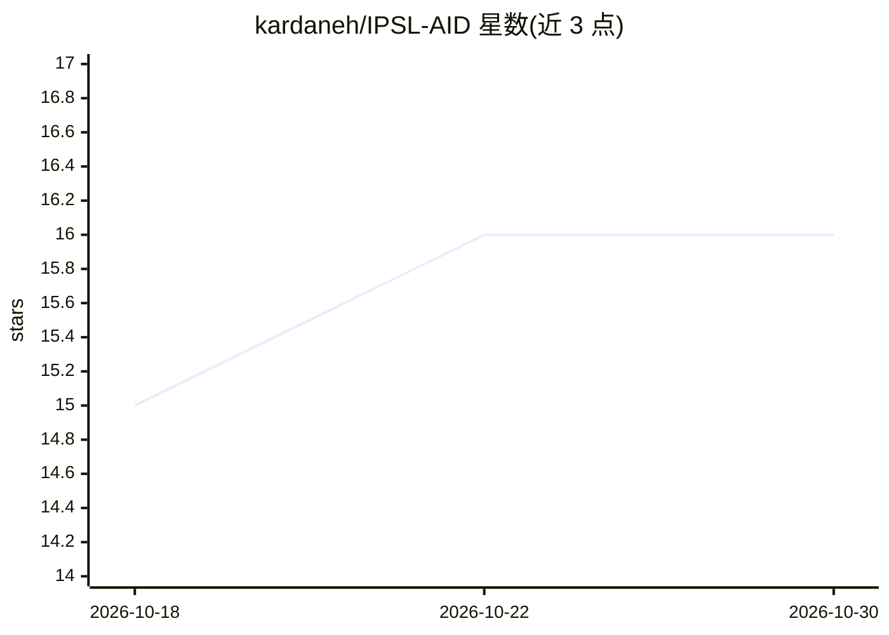

# kardaneh/IPSL-AID

⭐ 16 · Jupyter Notebook · NOASSERTION · 推送 2026-10-29 · [GitHub](https://github.com/kardaneh/IPSL-AID) · [官网](https://kardaneh.github.io/IPSL-AID/index.html) · 组织维护

**面向 GPU 集群/HPC 的气候数据降尺度扩散模型研究框架**

IPSL-AID 是基于扩散模型的气候数据降尺度研究框架，面向 GPU 集群与 HPC 系统设计，由 CNRS 开发（2026 年）。本体为生成式扩散模型实现，将全球尺度气候数据降尺度至区域尺度。README 未给出安装或运行命令，安装信息位于外部文档（readthedocs）。采用 CC BY-NC-SA 4.0 许可，禁止商用，商业授权需联系作者。有 arXiv 预印本（2604.03275）与 CI、文档徽章。

## 筛选速览

| 维度 | 判定 | 备注 |
|---|---|---|
| AI 角色 | `ai-native` | 本体是模型或模型工具 |
| 许可风险 | `none` | NOASSERTION |
| 部署形态 | `None` |  |
| 模型依赖 | — | README 未给出锁定关系 |
| 硬件要求 | — | 无带数字的原话,不猜 |
| 安装摩擦 | `low` | 无编译、无系统依赖或容器化 |
| 成熟度 | — | 结构信号不足 |

## 能力要点

- 基于扩散模型的气候数据降尺度（全球到区域尺度）
- 面向 GPU 集群与 HPC 系统设计
- 提供 arXiv 预印本与 readthedocs 文档
- 由 CNRS 开发，Grantham 基金会项目资助

## 适用场景

- 在全球气候模式输出上做区域高分辨率降尺度
- 科研团队在 HPC 集群上训练/评估扩散降尺度模型
- 气候科学研究中引用与复现生成式降尺度方法

## 场景标签

`科研工具` · 领域:学习与行业

## 证据(README 行号)

> L9: **IPSL-AID** is a high-performance research framework for **climate data downscaling**
> L10: based on **diffusion models**, designed for **GPU clusters and HPC systems**.
> L76:  title={IPSL-AID: Generative Diffusion Models for Climate Downscaling from Global to Regional Scales},

## 星数曲线

2026-10-18 15 → 2026-10-30 16（+1）

---
*卡片 v1 · prompt 1.4 · 生成 2026-10-30 · 置信度 high · 依据 README sha `3be1ad8c5330` · [字段定义](../../DATASET.md)*
