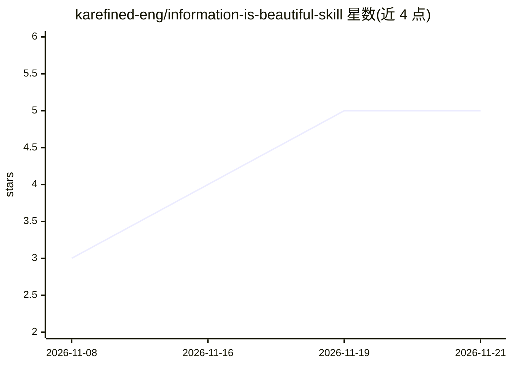

# karefined-eng/information-is-beautiful-skill

⭐ 5 · TypeScript · MIT · 推送 2026-11-14 · [GitHub](https://github.com/karefined-eng/information-is-beautiful-skill) · [官网](https://information-is-beautiful-skill.vercel.app) · 个人维护

**教 AI Agent 生成诚实数据可视化的技能包（五法则+图表匹配+审计）**

一个纯 markdown 的 Agent Skill（SKILL.md + 6 个参考文件，无二进制、无网络调用），内容是对 David McCandless《Information is Beautiful》设计理念的自创 MIT 授权综述。提供五条图表法则、chart-matcher 图表形式匹配、quality-checklist 25 点质量清单与三种阅读深度的工作流，支持 Shape/Build/Audit/Fix 四种请求模式。面向 Claude Code、Codex、Cursor 等 Agent-Skills 兼容客户端，通过 npx 安装或复制目录到各客户端的 skills 目录，可用斜杠命令显式调用或由描述匹配自动触发。

## 筛选速览

| 维度 | 判定 | 备注 |
|---|---|---|
| AI 角色 | `ai-knowledge` | 知识聚合/清单类 |
| 许可风险 | `permissive` | MIT |
| 部署形态 | `library` | 以包/库形式分发 |
| 模型依赖 | locked-api |  |
| 硬件要求 | — | 无带数字的原话,不猜 |
| 安装摩擦 | `low` | 无编译、无系统依赖或容器化 |
| 成熟度 | — | 结构信号不足 |

## 能力要点

- 五法则体系：形式随数据、诚实刻度、色彩即数据通道、墨水须挣得、注释即叙事
- chart-matcher 按数据变量类型选图表形式，quality-checklist 逐项审计
- 四种请求模式（Shape/Build/Audit/Fix）定义各自必做行为
- 纯 markdown 实现，无二进制、无网络

## 适用场景

- 让 AI Agent 把 CSV 数据集转成信息图或仪表盘
- 审计现有图表是否存在误导性设计、杂乱或可读性问题
- 为数据集选合适的图表形式（柱/线/饼等）
- 为演示文稿中的图表做诚实性与可访问性检查

## 场景标签

`提示工程` · 领域:Agent 开发

## 证据(README 行号)

> L11:  An Agent Skill that teaches AI agents to design beautiful, honest information
> L80: **One command (any Agent-Skills-compatible agent):**
> L109: The skill follows the agentskills.io progressive-disclosure model, so most of

## 星数曲线

2026-11-08 3 → 2026-11-21 5（+2）

---
*卡片 v1 · prompt 1.4 · 生成 2026-11-21 · 置信度 high · 依据 README sha `fc3d14e341e9` · [字段定义](../../DATASET.md)*
