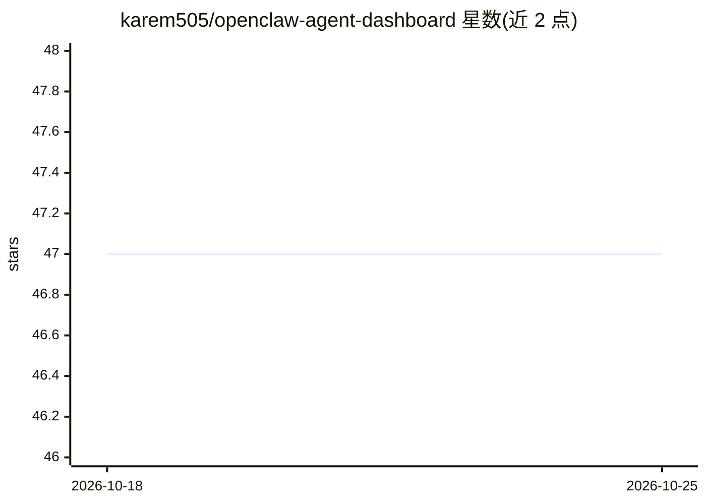

# karem505/openclaw-agent-dashboard

⭐ 47 · HTML · MIT · 推送 2026-10-24 · [GitHub](https://github.com/karem505/openclaw-agent-dashboard) · [官网](https://aboelmakarem.pro) · 个人维护

**管理 OpenClaw AI agent 的单文件玻璃拟态 Web 仪表盘**

以纯 HTML/CSS/JavaScript 单文件实现的 OpenClaw agent 管理界面：提供任务看板（拖拽、状态过滤、批量操作、并行执行）、Markdown 文档编辑器、11 个已连接 API 的可视化监控卡片、实时 agent 日志流（含 token 统计）与会话面板；另含独立的 Server Monitor 页面展示 CPU/内存/磁盘/网络指标与进程表。安装方式为将 HTML 文件复制进 OpenClaw control-ui 目录或用任意 Web 服务器托管，通过标准 OpenClaw REST 端点（/tasks、/agents、/metrics 等）通信，token 认证。Fork 版本增加登录页、移动端底部导航、PWA 支持与 macOS LaunchAgent 自启。

## 筛选速览

| 维度 | 判定 | 备注 |
|---|---|---|
| AI 角色 | `ai-ecosystem` | LLM/agent 周边工具 |
| 许可风险 | `permissive` | MIT |
| 部署形态 | `None` |  |
| 模型依赖 | — | README 未给出锁定关系 |
| 硬件要求 | — | 无带数字的原话,不猜 |
| 安装摩擦 | `low` | 无编译、无系统依赖或容器化 |
| 成熟度 | — | 结构信号不足 |

## 能力要点

- 任务列表与看板视图：拖拽、状态过滤、批量操作、并行任务执行
- 实时 agent 日志流与会话面板，含 token 用量统计
- 独立的 Server Monitor 页面：CPU/内存/磁盘/网络仪表与进程表，每 5 秒轮询 /metrics
- 零构建步骤的单文件 HTML，通过标准 OpenClaw REST 端点连接

## 适用场景

- 在统一界面中查看和操作 OpenClaw agent 的任务、文档与日志
- 通过手机经公开 URL 远程监控 agent 运行状态（PWA 支持）
- 在同一仪表盘中查看运行 OpenClaw 的服务器资源指标

## 场景标签

`LLM 可观测性` · 领域:评测与运维

## 证据(README 行号)

> L5: **Glassmorphic agent management dashboard for OpenClaw**
> L109: The dashboard connects to standard OpenClaw REST endpoints:
> L39: - **Task Management** — List & Kanban views with drag-and-drop, status filters (New / In Progress / Done / Failed),

## 星数曲线

2026-10-18 47 → 2026-10-25 47（+0）

---
*卡片 v1 · prompt 1.4 · 生成 2026-10-25 · 置信度 high · 依据 README sha `c73e3716e146` · [字段定义](../../DATASET.md)*
