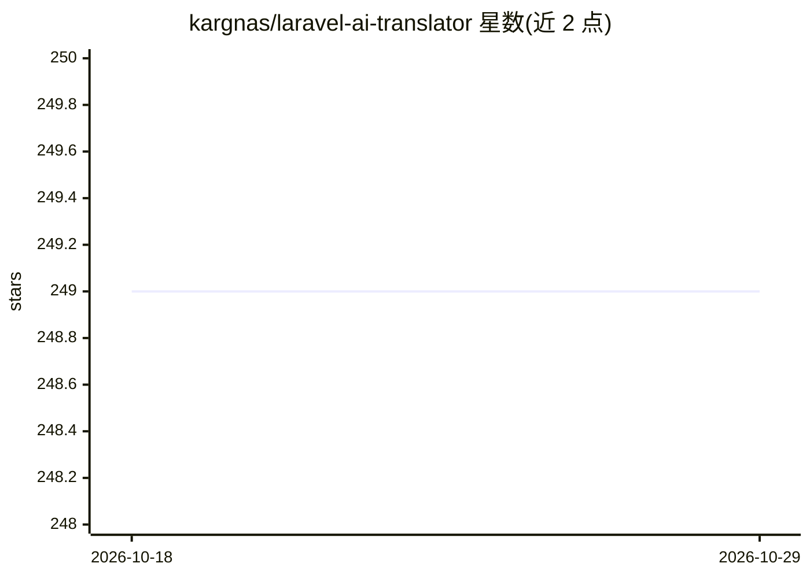

# kargnas/laravel-ai-translator

⭐ 249 · PHP · MIT · 推送 2026-10-27 · [GitHub](https://github.com/kargnas/laravel-ai-translator) · [官网](https://kargn.as/projects/laravel-ai-translator) · 个人维护

**用 AI 将 Laravel 语言文件自动翻译成多语言的包**

Laravel 的 Composer 包，通过 artisan 命令读取 lang 目录下源语言（默认英语）的 PHP 语言文件，调用 AI 生成其他语言翻译，支持多 locale 并行翻译。默认走 OpenRouter（Laravel AI SDK），也保留 OpenAI、Anthropic、Gemini 直连。附带查找并清理未使用翻译键、清除已有翻译以重新生成等辅助命令，翻译时保留变量、HTML 标签、复数形式与嵌套结构，支持分块以减少 API 开销，并支持自定义语言风格（如东北话、Reddit 英语）。要求 PHP 8.3+ 与 Laravel 12.0+。

## 筛选速览

| 维度 | 判定 | 备注 |
|---|---|---|
| AI 角色 | `ai-native` | 本体是模型或模型工具 |
| 许可风险 | `permissive` | MIT |
| 部署形态 | `None` |  |
| 模型依赖 | locked-api |  |
| 硬件要求 | — | 无带数字的原话,不猜 |
| 安装摩擦 | `low` | 无编译、无系统依赖或容器化 |
| 成熟度 | — | 结构信号不足 |

## 能力要点

- php artisan ai-translator:translate 一条命令翻译全部语言文件，支持并行
- 默认经 OpenRouter 接入，保留 OpenAI/Anthropic/Gemini 直连
- 保留变量、HTML、复数与嵌套结构，支持分块降低 API 成本与翻译校验
- 内置 find-unused 与 clean 命令管理未使用键与重新翻译

## 适用场景

- 我的 Laravel 应用需要快速补齐多语言翻译文件
- 清理代码中已不再使用的翻译键
- 更换模型或规则后批量重新生成翻译

## 场景标签

`AI 写作` · 领域:内容生成

## 证据(README 行号)

> L72: - Translates PHP language files from a source language (default: English) to all other languages
> L168: php artisan ai-translator:translate

## 星数曲线

2026-10-18 249 → 2026-10-29 249（+0）

---
*卡片 v1 · prompt 1.4 · 生成 2026-10-22 · 置信度 high · 依据 README sha `53a0d7319c92` · [字段定义](../../DATASET.md)*
