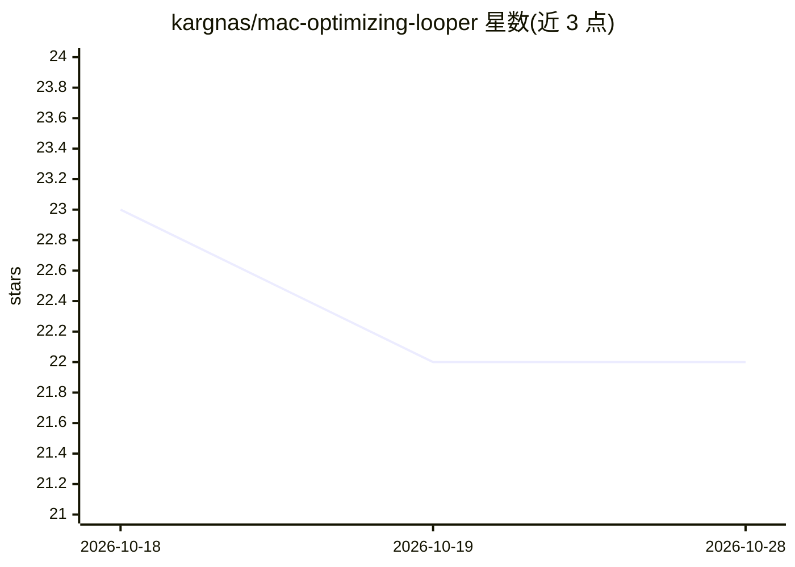

# kargnas/mac-optimizing-looper

⭐ 22 · Swift · MIT · 推送 2026-07-26 · [GitHub](https://github.com/kargnas/mac-optimizing-looper) · 个人维护 · 中文 README

**macOS 菜单栏 AI 性能分析器：让 Claude/Codex 定位拖慢系统的进程**

无 Dock 图标的 macOS 菜单栏应用，按设定间隔（默认 1 小时，可调 10 分钟至 36 小时）采集 CPU/内存与进程快照，发送给本地 Claude 或 Codex CLI 做分析，生成按严重度排序、带具体修复命令的建议列表。执行需用户点击，且命令先经第二次 Claude 风险判定为 SAFE 才运行；非 SAFE 或 unknown 默认取消。要求 macOS 13+ 且本机已装 claude/codex CLI，否则不产出建议。Swift 编写，MIT 许可。

## 筛选速览

| 维度 | 判定 | 备注 |
|---|---|---|
| AI 角色 | `ai-native` | 本体是模型或模型工具 |
| 许可风险 | `permissive` | MIT |
| 部署形态 | `None` |  |
| 模型依赖 | — | README 未给出锁定关系 |
| 硬件要求 | — | 无带数字的原话,不猜 |
| 安装摩擦 | `low` | 无编译、无系统依赖或容器化 |
| 成熟度 | — | 结构信号不足 |

## 能力要点

- 定时采集系统指标并调用 Claude/Codex 生成排序修复建议
- 双重安全门：命令执行前经 Claude 判定 SAFE，非 SAFE 默认取消
- 支持 claude/codex 双后端，可用 argv 前缀替换可执行命令
- 零遥测，数据仅通过用户自己的 CLI 发送

## 适用场景

- 想知道 Mac 变慢的具体原因而不是重启碰运气
- 获取一键执行的进程终止/修复命令
- 在菜单栏持续监控系统负载并获得 AI 建议

## 场景标签

 · 领域:系统工具/性能监控

## 证据(README 行号)

> L12: Every hour, your Mac's load goes to Claude. It ranks what's *actually* hogging your CPU/RAM, writes the exact fix, 
> L14: **Mac Optimizing Looper** is a macOS menu-bar app (no Dock icon) that runs a continuous **observe → ask the model →
> L62: Needs a working Claude or Codex CLI command. Defaults are `claude` and `codex`; both can

## 星数曲线

2026-10-18 23 → 2026-10-28 22（-1）

---
*卡片 v1 · prompt 1.4 · 生成 2026-10-27 · 置信度 high · 依据 README sha `9630943b838f` · [字段定义](../../DATASET.md)*
