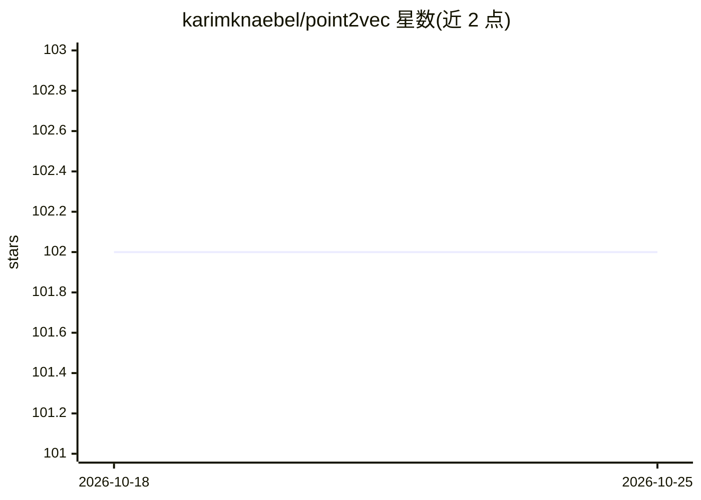

# karimknaebel/point2vec

⭐ 102 · Python · MIT · 推送 2026-01-26 · [GitHub](https://github.com/karimknaebel/point2vec) · [官网](https://karimknaebel.github.io/point2vec/) · 个人维护

**点云自监督预训练模型：学习点云表征用于分类与分割**

GCPR 2023 论文 point2vec 的官方 PyTorch 实现：在 ShapeNet 上以自监督方式预训练 Transformer，得到点云表征；提供 Model Zoo 中在 ModelNet40（94.65/94.77）、ScanObjectNN（87.47）、ShapeNetPart（84.59）上微调后的分类与部件分割检查点。训练与复现脚本基于 PyTorch Lightning 与 Weights & Biases，环境指定 Python 3.10.4、CUDA 11.6、cuDNN 8.4.0；README 说明 ModelNet40 结果跨运行方差较大，需在指定环境（Volta GPU 如 V100）下才能精确复现。面向点云/三维视觉方向的研究人员。

## 筛选速览

| 维度 | 判定 | 备注 |
|---|---|---|
| AI 角色 | `ai-native` | 本体是模型或模型工具 |
| 许可风险 | `permissive` | MIT |
| 部署形态 | `library` | 以包/库形式分发 |
| 模型依赖 | — | README 未给出锁定关系 |
| 硬件要求 | — | 无带数字的原话,不猜 |
| 安装摩擦 | `high` | 编译与系统依赖俱全 |
| 成熟度 | — | 结构信号不足 |

## 能力要点

- ShapeNet 自监督预训练的点云 Transformer
- 提供分类（ModelNet40/ScanObjectNN/少样本）与部件分割的微调脚本
- Model Zoo 提供预训练与微调检查点
- 附 data2vec-pc 与 from-scratch 基线复现命令

## 适用场景

- 对自有点云数据做下游分类或分割任务的预训练初始化
- 复现论文中各数据集的实验结果
- 对比自监督点云表征学习方法（data2vec-pc 基线）

## 场景标签

`模型训练` `微调` · 领域:训练与推理

## 证据(README 行号)

> L3: Self-Supervised Representation Learning on Point Clouds
> L37: |Type|Dataset|Evaluation|Config|Checkpoint|
> L58: ./scripts/pretraining_shapenet.bash --data.in_memory true

## 星数曲线

2026-10-18 102 → 2026-10-25 102（+0）

---
*卡片 v1 · prompt 1.4 · 生成 2026-10-23 · 置信度 high · 依据 README sha `63f1301a8a0c` · [字段定义](../../DATASET.md)*
