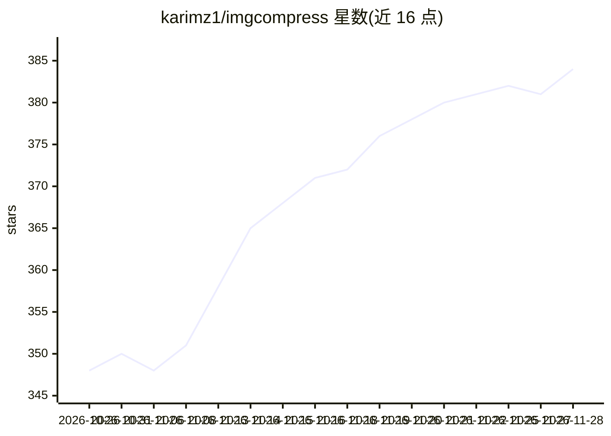

# karimz1/imgcompress

⭐ 384 · TypeScript · GPL-3.0 · 推送 2026-11-27 · [GitHub](https://github.com/karimz1/imgcompress) · [官网](https://imgcompress.karimzouine.com) · 个人维护

**自托管图片工具箱：本地压缩、转换格式与 AI 抠图/放大**

以单个 Docker 容器运行的自托管图片处理应用，提供 Web 界面与 CLI 两种使用方式。功能覆盖 70+ 格式的读取与转换（HEIC、PSD、SVG、EPS 等）、批量压缩、浏览器内编辑（裁剪、文字、Logo、社交尺寸预设）、图片转分页 PDF、AI 抠图与 AI 放大（最高 16K，CPU 运行）。全部处理在本地容器内完成，不上传外部服务，支持 12 种界面语言，GPL-3.0 许可。

## 筛选速览

| 维度 | 判定 | 备注 |
|---|---|---|
| AI 角色 | `ai-native` | 本体是模型或模型工具 |
| 许可风险 | `viral` | GPL-3.0 |
| 部署形态 | `self-host` | docker 或自建部署 |
| 模型依赖 | — | README 未给出锁定关系 |
| 硬件要求 | — | 无带数字的原话,不猜 |
| 安装摩擦 | `low` | 无编译、无系统依赖或容器化 |
| 成熟度 | — | 结构信号不足 |

## 能力要点

- 70+ 图片格式读取与转换，含 HEIC、PSD、SVG、EPS、PDF
- 内置 AI 抠图与 AI 放大（General/Anime 模式，CPU 运行，无需显卡）
- 单容器部署，Web 界面与 CLI 双入口，离线可用
- 浏览器内图片编辑器：裁剪、精确尺寸、文字水印、社交平台尺寸预设

## 适用场景

- 把手机 HEIC 和设计稿 PSD 批量转成常见图片格式
- 本地一键去除照片背景，文件不出服务器
- 将低分辨率图片或动漫图放大到高分辨率
- 把截图或图片批量合成 PDF 用于邮件分享

## 场景标签

`图像视频处理` · 领域:感知与多模态

## 证据(README 行号)

> L57: ImgCompress is a **self-hosted image app in a single Docker container**, easy for everyone with no IT knowledge nee
> L64: |**AI Background Removal**|Built in and ready to use. No account, no subscription, no upload|

## 星数曲线

2026-10-26 348 → 2026-11-28 384（+36）

---
*卡片 v1 · prompt 1.4 · 生成 2026-11-25 · 置信度 high · 依据 README sha `bea4cc9cf9a3` · [字段定义](../../DATASET.md)*
