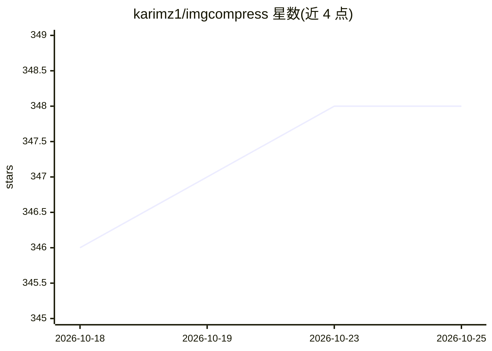

# karimz1/imgcompress

⭐ 348 · TypeScript · GPL-3.0 · 推送 2026-10-24 · [GitHub](https://github.com/karimz1/imgcompress) · [官网](https://imgcompress.karimzouine.com) · 个人维护 · 中文 README

**自托管图像处理工具箱：70+ 格式转换、压缩与本地 AI 抠图**

运行于单个 Docker 容器的自托管图像处理服务，面向个人与 homelab 用户。功能包括 70+ 输入格式（PSD/HEIC/EPS/RAW 等）的批量压缩与格式转换、图片生成 PDF、逐文件裁剪（比例预设与自定义像素），以及基于内置模型的本地 AI 背景移除（CPU 运行，无需 API key）。提供浏览器 Web UI 与 CLI，镜像拉取后可完全离线运行，UI 支持 12 种语言。采用 GPL-3.0 许可。

## 筛选速览

| 维度 | 判定 | 备注 |
|---|---|---|
| AI 角色 | `ai-enhanced` | 去掉 AI 部分产品仍成立 |
| 许可风险 | `viral` | GPL-3.0 |
| 部署形态 | `self-host` | docker 或自建部署 |
| 模型依赖 | — | README 未给出锁定关系 |
| 硬件要求 | — | 无带数字的原话,不猜 |
| 安装摩擦 | `low` | 无编译、无系统依赖或容器化 |
| 成熟度 | — | 结构信号不足 |

## 能力要点

- 支持 70+ 图像输入格式（含 PSD/HEIC/EPS/TIFF）
- 内置模型在本地 CPU 运行 AI 背景移除，无需 API key
- 批量压缩与多核并行处理
- 单容器部署，拉取后可完全离线运行

## 适用场景

- 在不联网的环境里批量转换与压缩照片库
- 把 HEIC/PSD 等格式转为常用格式或合并为 PDF
- 在自有服务器上对个人或客户照片做背景移除

## 场景标签

`图像视频处理` · 领域:感知与多模态

## 证据(README 行号)

> L55: ImgCompress is a **self-hosted image processing server** that runs entirely inside a single Docker container. It ha
> L64: |**Local AI Background Removal**|Bundled model runs on your CPU. No API key, no subscription, no upload|

## 星数曲线

2026-10-18 346 → 2026-10-25 348（+2）

---
*卡片 v1 · prompt 1.4 · 生成 2026-10-21 · 置信度 high · 依据 README sha `a494aaeea634` · [字段定义](../../DATASET.md)*
