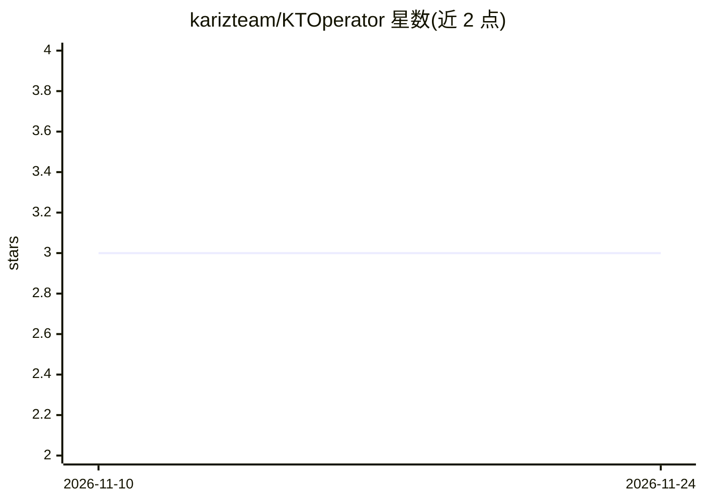

# karizteam/KTOperator

⭐ 3 · TypeScript · MIT · 推送 2026-11-08 · [GitHub](https://github.com/karizteam/KTOperator) · [官网](karizteam.ir) · 组织维护

**终端里的多 provider AI agent，带策略引擎与沙箱执行**

ktOperator 是运行在终端的交互式 AI agent：用户用自然语言描述任务，它规划、读写文件、运行命令并自查，全部限制在授权的单一 workspace 内。核心机制是安全流水线：schema 校验→风险分级→策略引擎裁决→必要的人工批准→沙箱执行→密钥脱敏→审计日志，模型不能自批操作。支持 OpenRouter、OpenAI、Anthropic、Gemini、OpenAI 兼容端点与本地 Ollama 六类 provider，提供检查点回滚、diff 预览、会话恢复、技能/提示模板与脚本化 CLI。需 Node.js 22.12+，npm 全局安装。

## 筛选速览

| 维度 | 判定 | 备注 |
|---|---|---|
| AI 角色 | `ai-native` | 本体是模型或模型工具 |
| 许可风险 | `permissive` | MIT |
| 部署形态 | `self-host` | docker 或自建部署 |
| 模型依赖 | local-ok | 支持本地模型 |
| 硬件要求 | — | 无带数字的原话,不猜 |
| 安装摩擦 | `low` | 无编译、无系统依赖或容器化 |
| 成熟度 | — | 结构信号不足 |

## 能力要点

- 每个动作经策略引擎裁决并写入审计日志，模型不能自批操作
- 每任务自动检查点，/undo 恢复文件并以彩色 diff 预览
- 六类 provider 统一接口，Docker 沙箱提供最强隔离
- CLI 与交互控制台双形态，支持 --json/--dry-run/--token-budget

## 适用场景

- 让 agent 分析/修改项目代码，改动前有快照可回滚
- 在受控沙箱里让 AI 跑测试、构建与 shell 命令
- 需要审批流与审计日志的自动化运维任务

## 场景标签

`编码 Agent` · 领域:编码与开发

## 证据(README 行号)

> L14: **ktOperator** is a terminal AI agent you can actually hand your machine to. You describe a task in plain language 
> L60: |1|**Provider**|Pick OpenRouter, OpenAI, Anthropic, Google Gemini, any OpenAI-compatible endpoint, or local Ollama|
> L20: The AI can suggest anything, but it can never approve its own actions, run a command without a sandbox, read outsid

## 星数曲线

2026-11-10 3 → 2026-11-24 3（+0）

---
*卡片 v1 · prompt 1.4 · 生成 2026-11-22 · 置信度 mid · 依据 README sha `d7b14cca79f9` · [字段定义](../../DATASET.md)*
