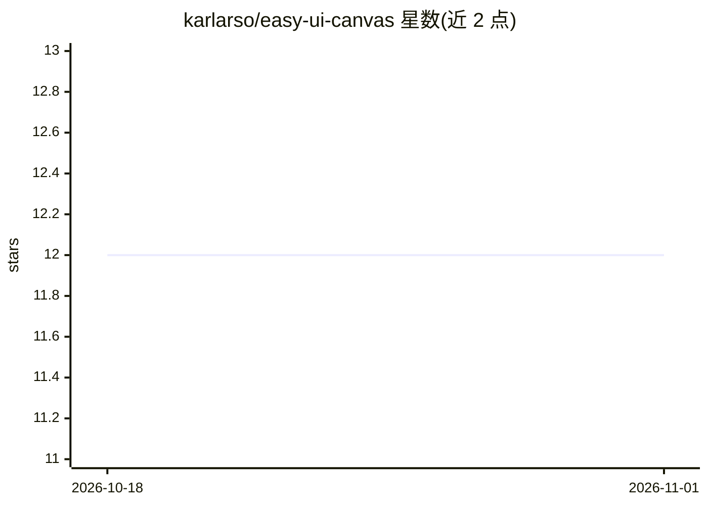

# karlarso/easy-ui-canvas

⭐ 12 · Python · Apache-2.0 · 推送 2026-10-26 · [GitHub](https://github.com/karlarso/easy-ui-canvas) · 个人维护 · 中文 README

**本地多帧 UI 设计画布：评论元素、点击走流程，AI 编码代理接单**

纯 Python 标准库实现的本地 Web 画布工具：将多个 HTML/CSS 页面帧并排放在可缩放平移的画板上，支持对单个元素锚定评论、手机只读预览（二维码）、data-goto 可点击原型、快照回看与 ZIP 手递手导出。面向使用 Claude Code / Cursor / Codex 等 AI 编码代理的开发者：画布列表页在 /agent.md 提供 Agent 指南，代理读取评论并直接修改文件回复；部署也可交给 AI 代理按 DEPLOY.md 完成。无构建步骤、无第三方 Python 包；默认仅监听 127.0.0.1，无鉴权，macOS/Linux 支持，Windows 需 WSL。

## 筛选速览

| 维度 | 判定 | 备注 |
|---|---|---|
| AI 角色 | `ai-ecosystem` | LLM/agent 周边工具 |
| 许可风险 | `permissive` | Apache-2.0 |
| 部署形态 | `library` | 以包/库形式分发 |
| 模型依赖 | — | README 未给出锁定关系 |
| 硬件要求 | — | 无带数字的原话,不猜 |
| 安装摩擦 | `low` | 无编译、无系统依赖或容器化 |
| 成熟度 | — | 结构信号不足 |

## 能力要点

- 元素级锚定评论，AI 代理读取后修改文件回复（/agent.md Agent 指南）
- 多帧 HTML/CSS 画布 + data-goto 可点击流程 + 手机只读预览
- 仅依赖 Python 3 标准库，无构建步骤、无第三方 Python 包
- 快照、UI handoff ZIP 导出、git 友好的纯文件项目格式

## 适用场景

- 让 AI 编码代理画 UI 草图，我点击元素写评论、它改代码
- 把现有项目页面与改进版本并排对比
- 本地无账号保存设计画布，经 git 或 LAN/Tailscale 共享

## 场景标签

 · 领域:设计工具/开发辅助

## 证据(README 行号)

> L7: One prompt, a comment on a canvas element, then the agent edits the file and replies
> L36: A small local web canvas for **exploring UI designs**: put several HTML screens (frames) side by side on a zoomable
> L139: - 🤖 **Agent guide on the list**: “For agents” opens `/agent`. The same text is plain Markdown at `/agent.md`, so a

## 星数曲线

2026-10-18 12 → 2026-11-01 12（+0）

---
*卡片 v1 · prompt 1.4 · 生成 2026-11-01 · 置信度 mid · 依据 README sha `04d6fa1873d9` · [字段定义](../../DATASET.md)*
