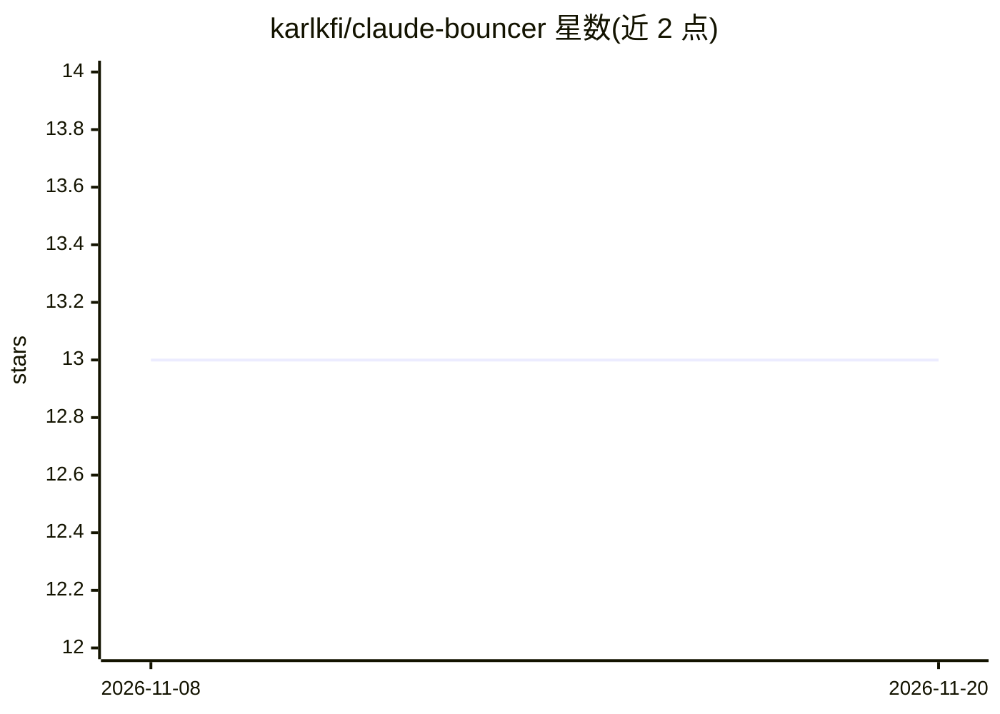

# karlkfi/claude-bouncer

⭐ 13 · Python · MIT · 推送 2026-11-18 · [GitHub](https://github.com/karlkfi/claude-bouncer) · 个人维护

**为 Claude Code 提供 PreToolUse 钩子防护的插件市场**

由五个独立 PreToolUse 钩子插件组成的 Claude Code 插件市场：workspace-guard 拦截越出工作区的读写、branch-guard 阻止受保护分支上的提交推送、prod-guard 拦截指向生产环境的变更命令、exit-status-guard 识别被掩盖的退出状态、foreground-guard 防止主线程阻塞。判定基于命令字符串解析而非命令名，结果分放行/询问/拒绝三类；拒绝理由附带改写建议并回传给模型自动重试。本地解析、无网络与模型调用，Python 3.9 为下限，MIT 许可。

## 筛选速览

| 维度 | 判定 | 备注 |
|---|---|---|
| AI 角色 | `ai-ecosystem` | LLM/agent 周边工具 |
| 许可风险 | `permissive` | MIT |
| 部署形态 | `None` |  |
| 模型依赖 | — | README 未给出锁定关系 |
| 硬件要求 | — | 无带数字的原话,不猜 |
| 安装摩擦 | `low` | 无编译、无系统依赖或容器化 |
| 成熟度 | — | 结构信号不足 |

## 能力要点

- 五个独立插件，可任意组合安装，各自带配置、override 与测试
- 读取命令参数做判定：放行/询问/拒绝三档，拒绝理由附改写建议回传模型
- 带理由的 override 机制，并留存在会话记录中
- /friction-report 命令统计规则触发频率

## 适用场景

- 让 Claude Code 代理操作时防止误改生产环境配置
- 阻止 agent 向 main 等受保护分支提交或推送
- 拦截读取出工作区之外敏感文件的 grep/sed/cat 命令
- 识别被管道或后台化掩盖的失败命令退出状态

## 场景标签

 · 领域:开发者工具/Agent 安全防护

## 证据(README 行号)

> L20: These five plugins are `PreToolUse` hooks that read the command arguments instead.
> L32: /plugin marketplace add karlkfi/claude-bouncer

## 星数曲线

2026-11-08 13 → 2026-11-20 13（+0）

---
*卡片 v1 · prompt 1.4 · 生成 2026-11-18 · 置信度 high · 依据 README sha `4e5ffc9367bc` · [字段定义](../../DATASET.md)*
