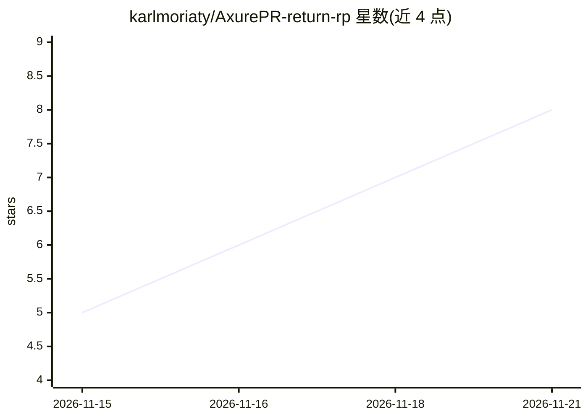

# karlmoriaty/AxurePR-return-rp

⭐ 8 · TypeScript · MIT · 推送 2026-11-20 · [GitHub](https://github.com/karlmoriaty/AxurePR-return-rp) · [官网](https://github.com/karlmoriaty/AxurePR-return-rp#quickstart) · 个人维护 · 中文 README

**给 Axure 用户：截图/需求/RP源码生成可编辑 .rp 原型**

面向 Axure RP 9 与 RP 11 的原型生成工具，提供 Studio 画布、CLI 与 MCP 三种入口。工作流：截图走临摹管线、需求/PRD 写成 RP/1 文本源码，经 Studio 画布推敲后生成原生 .rp 工程，也可导出浏览器预览与 HTML/CSS/JS。输出保持文字、按钮、输入框为独立元件，可在 Axure 中继续编辑。运行需 Node.js 18+ 与 Python 3.10+；仅生成原生 .rp、保存重开与自动预览需本机 Axure。

## 筛选速览

| 维度 | 判定 | 备注 |
|---|---|---|
| AI 角色 | `ai-native` | 本体是模型或模型工具 |
| 许可风险 | `permissive` | MIT |
| 部署形态 | `library` | 以包/库形式分发 |
| 模型依赖 | — | README 未给出锁定关系 |
| 硬件要求 | — | 无带数字的原话,不猜 |
| 安装摩擦 | `low` | 无编译、无系统依赖或容器化 |
| 成熟度 | — | 结构信号不足 |

## 能力要点

- 截图、需求或 RP/1 源码生成可编辑的原生 .rp 文件
- RP 9 与 RP 11 共用同一套 CLI、MCP 与 Studio，能力双向对齐
- Studio 画布支持 AI 与人共同编辑，按图层与语义局部改稿
- 提供三层验收：结构检查、浏览器交互、Axure 保存重开

## 适用场景

- 把产品需求或 PRD 直接生成可继续编辑的 Axure 原型
- 把已有设计截图转回 Axure 原生工程
- 通过 MCP 客户端把原型生成任务交给 Agent 执行
- 导出 HTML/CSS/JS 用于评审或嵌入

## 场景标签

`代码生成` · 领域:编码与开发

## 证据(README 行号)

> L1: return_rp · AI-native canvas. Editable Axure RP 9 / RP 11 output.
> L20: **一句话：把截图、需求描述或 RP/1 源码，变成可继续编辑的 Axure 原生工程，而不是一张原型截图。**
> L182: Agent 从 `studio_describe({"topic":"workflow"})` 开始。导入已有 RP/1 可为 `studio_open_project` 指定 `sourcePath`；完整原生生成使用 `ge

## 星数曲线

2026-11-15 5 → 2026-11-21 8（+3）

---
*卡片 v1 · prompt 1.4 · 生成 2026-11-20 · 置信度 high · 依据 README sha `8dd359a4dcd0` · [字段定义](../../DATASET.md)*
