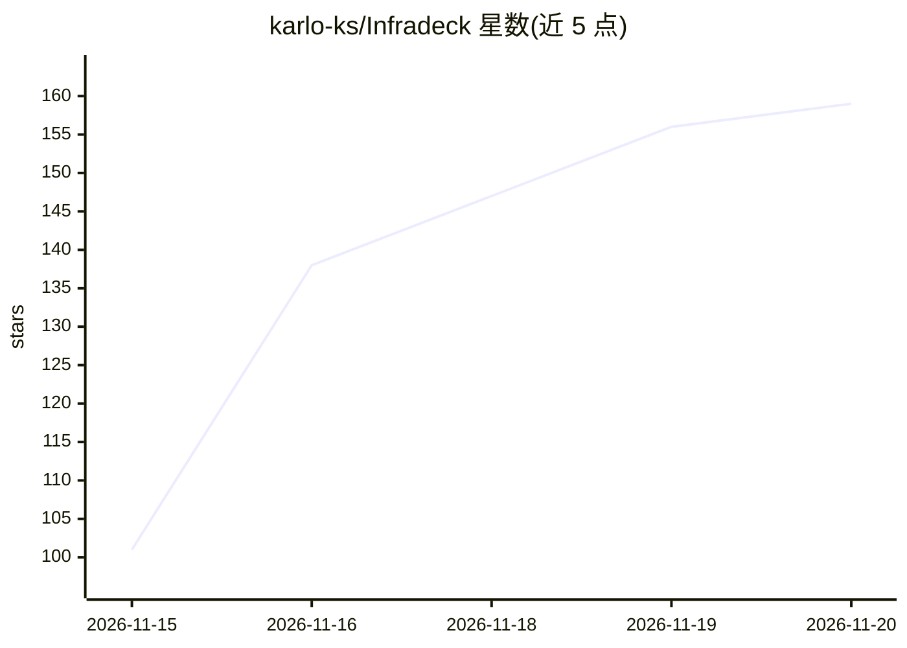

# karlo-ks/Infradeck

⭐ 159 · Python · AGPL-3.0 · 推送 2026-11-18 · [GitHub](https://github.com/karlo-ks/Infradeck) · 个人维护

**自托管家庭实验室监控面板，含可选 AI 事件诊断代理**

自托管的 homelab 监控系统：一台机器运行仪表盘，其余机器运行 collector 上报主机与 Docker 指标并执行可用性检查（HTTP/TCP/TLS/DNS/ICMP 等）。基于规则的告警生成事件，可选 AI 事件代理接入 Anthropic/OpenAI/Gemini API key，从脱敏证据诊断警告与严重事件并提出修复建议，但只读不执行命令。通过 Docker Compose 部署，collector 仅支持 Linux 上的 Docker，非日志收集器，非高分辨率时序数据库。

## 筛选速览

| 维度 | 判定 | 备注 |
|---|---|---|
| AI 角色 | `ai-enhanced` | 去掉 AI 部分产品仍成立 |
| 许可风险 | `viral` | AGPL-3.0 |
| 部署形态 | `self-host` | docker 或自建部署 |
| 模型依赖 | — | README 未给出锁定关系 |
| 硬件要求 | — | 无带数字的原话,不猜 |
| 安装摩擦 | `low` | 无编译、无系统依赖或容器化 |
| 成熟度 | — | 结构信号不足 |

## 能力要点

- 主机、容器与可用性检查集中在单一仪表盘，检查从用户自有机器运行
- 可选 AI 事件代理从脱敏证据诊断事件并提出修复，不执行任何命令
- collector 无特权、不接触 Docker socket，端点仅绑定 VPN 地址
- 管理员默认强制双因素登录，密码需 16 位以上

## 适用场景

- 在一个面板里查看多台服务器与容器的健康状态
- 从自己选定的机器运行可用性检查，区分服务故障与网络路径故障
- 让 AI 代理诊断告警事件并给出修复建议

## 场景标签

 · 领域:运维监控/自托管基础设施

## 证据(README 行号)

> L4:  Self-hosted monitoring for your homelab: every server, every container and every service you run, in one dashboard.
> L27: - **An optional AI incident agent that only reads.** It diagnoses warning and critical incidents from masked data a

## 星数曲线

2026-11-15 101 → 2026-11-20 159（+58）

---
*卡片 v1 · prompt 1.4 · 生成 2026-11-17 · 置信度 mid · 依据 README sha `d9a396ba186c` · [字段定义](../../DATASET.md)*
