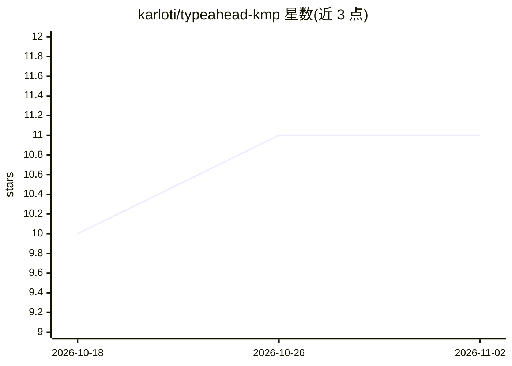

# karloti/typeahead-kmp

⭐ 11 · Kotlin · Apache-2.0 · 推送 2026-04-16 · [GitHub](https://github.com/karloti/typeahead-kmp) · [官网](https://smartcoding.youtrack.cloud/projects/typeahead_kmp) · 个人维护

**给 Kotlin 开发者的跨平台内存模糊搜索引擎库**

面向 Kotlin Multiplatform 的内存模糊搜索引擎库：基于 L2 归一化稀疏向量、倒排索引与 N-gram 等技术，在设备本地完成容错搜索，支持多词查询、换位/漏字容忍，以 StateFlow 流式返回 [0,1] 归一化相似度结果。搜索为无锁并发设计，支持 JVM、iOS、Android、JS、Wasm 等目标。提供导出/导入预计算向量状态以消除冷启动，并输出字符级匹配 heatmap 用于 UI 高亮。以 Gradle 依赖形式集成到 commonMain 源集。

## 筛选速览

| 维度 | 判定 | 备注 |
|---|---|---|
| AI 角色 | `ai-ecosystem` | LLM/agent 周边工具 |
| 许可风险 | `permissive` | Apache-2.0 |
| 部署形态 | `None` |  |
| 模型依赖 | — | README 未给出锁定关系 |
| 硬件要求 | — | 无带数字的原话,不猜 |
| 安装摩擦 | `low` | 无编译、无系统依赖或容器化 |
| 成熟度 | `idea` | |

## 能力要点

- L2 归一化稀疏向量空间与倒排索引实现容错模糊搜索
- 无锁并发（MutableStateFlow + PersistentMap/HAMT），支持多目标平台编译
- 多词查询用几何/调和均值、指数邻近衰减与 BM25 式长度归一化聚合打分
- 支持导出/导入预计算向量状态（流式 JSON）消除冷启动，提供字符级 heatmap 高亮

## 适用场景

- 在跨平台 App 中实现即时本地自动补全与容错搜索
- 为搜索框提供打字过程中带拼写容错的多词检索
- 预计算向量状态随构建分发，避免客户端冷启动计算

## 场景标签

`语义搜索` · 领域:知识与检索

## 证据(README 行号)

> L5: A high-performance, asynchronous, and lock-free in-memory fuzzy search engine designed specifically for Kotlin
> L6: Multiplatform (KMP).
> L14: Powered by a custom **L2-Normalized Sparse Vector Space** algorithm, a **Flyweight Vocabulary Cache**, an **Inverte
> L15: Index**, and immutable state management, it acts as a highly optimized, local vector database. Each query token is

## 星数曲线

2026-10-18 10 → 2026-11-02 11（+1）

---
*卡片 v1 · prompt 1.4 · 生成 2026-11-02 · 置信度 high · 依据 README sha `dd0306458e01` · [字段定义](../../DATASET.md)*
