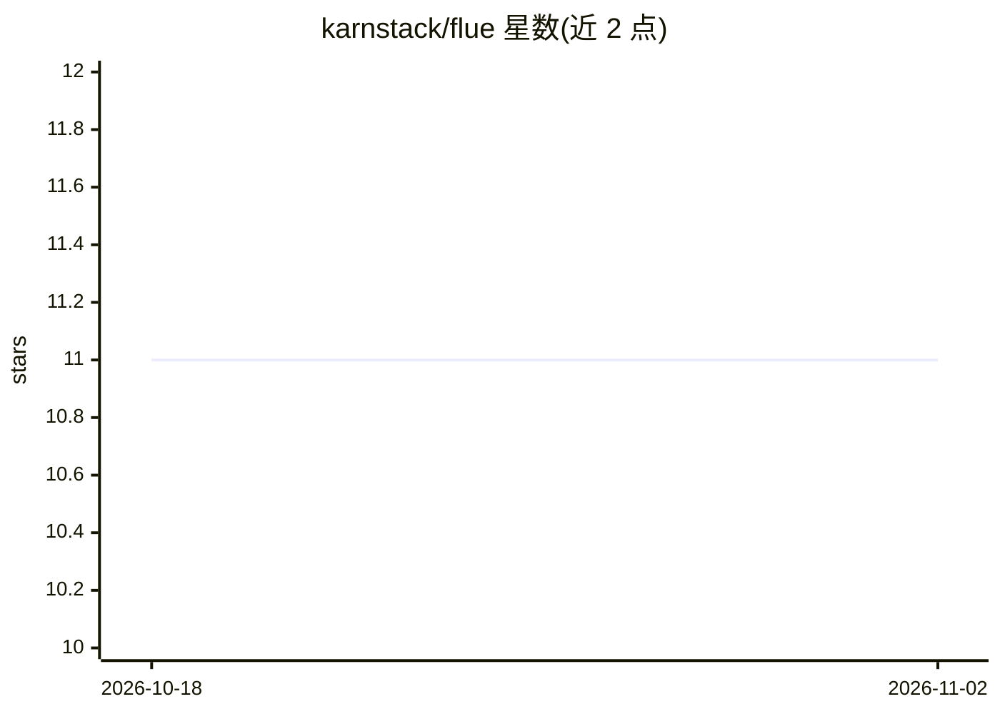

# karnstack/flue

⭐ 11 · TypeScript · MIT · 推送 2026-08-26 · [GitHub](https://github.com/karnstack/flue) · [官网](https://flue.sh) · 个人维护

**浏览器访问的终端会话守护进程：跨设备管理 Claude Code 等会话**

单个静态 Go 二进制，包含守护进程与 Web 应用：在每个持有终端会话的机器上运行，会话各驻独立 holder 进程，守护进程崩溃或重启后会话可带历史恢复。Web 界面按机器或标签聚合列出全部会话（Claude Code、Codex、Pi、SSH、构建），支持命名、置顶、搜索、分屏、手机/平板 QR 配对与双设备镜像。多机组网通过部署到用户自己 Cloudflare 账号的 relay Worker，流量端到端 Noise IK 加密。可搜索全部 agent 对话历史并查看每日 token 与费用。限制：0.x 版本，命令与配置仍可能变化。

## 筛选速览

| 维度 | 判定 | 备注 |
|---|---|---|
| AI 角色 | `ai-ecosystem` | LLM/agent 周边工具 |
| 许可风险 | `permissive` | MIT |
| 部署形态 | `desktop` | 安装包/桌面程序 |
| 模型依赖 | — | README 未给出锁定关系 |
| 硬件要求 | — | 无带数字的原话,不猜 |
| 安装摩擦 | `low` | 无编译、无系统依赖或容器化 |
| 成熟度 | `idea` | |

## 能力要点

- 会话独立于浏览器标签与守护进程存活，重启后可恢复
- 单静态 Go 二进制，macOS/Linux/WSL，无 Node/Python 依赖
- relay Worker 部署到用户自有 Cloudflare 账号，端到端 Noise IK 加密，无 flue 托管服务
- 聚合全部机器的 Claude Code/Codex/Pi 对话历史，含每日 token 与费用

## 适用场景

- 在手机或平板上继续查看并操作另一台机器上的 Claude Code/Codex 会话
- 把多台机器上的终端和 agent 会话收进一个列表统一管理
- 关闭浏览器标签后让 agent 继续运行，稍后回到带回放的会话
- 自托管地远程访问家中机器上的终端

## 场景标签

 · 领域:开发者工具/终端

## 证据(README 行号)

> L20: flue is a daemon that keeps terminal sessions alive, and a web app that lists
> L37: - **Agent history.** Every Claude Code, Codex and Pi conversation from every
> L38:  machine. Search it, see tokens and cost per day, read the transcript, resume

## 星数曲线

2026-10-18 11 → 2026-11-02 11（+0）

---
*卡片 v1 · prompt 1.4 · 生成 2026-11-02 · 置信度 high · 依据 README sha `0bf917e26e05` · [字段定义](../../DATASET.md)*
