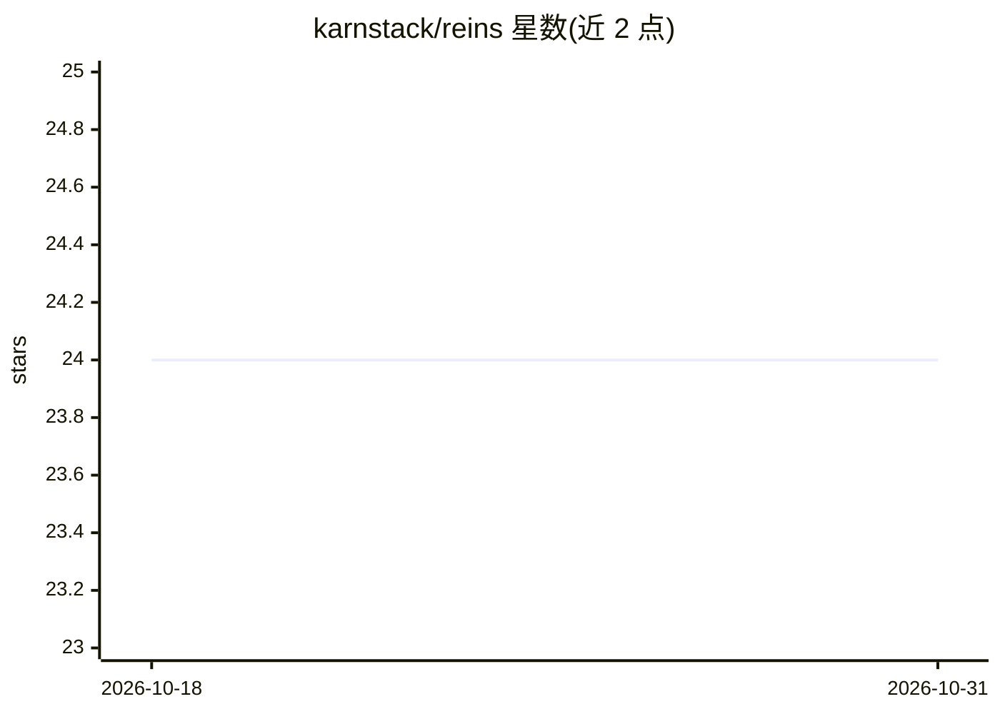

# karnstack/reins

⭐ 24 · TypeScript · MIT · 推送 2026-10-03 · [GitHub](https://github.com/karnstack/reins) · [官网](https://reins.tech) · 个人维护

**让编码 agent 控制真实已登录 Chromium 浏览器的 CLI 与扩展**

由 CLI（含按需启动的守护进程）与 Manifest V3 扩展组成，使 Claude Code、Cursor、Codex、Copilot 等任何带 shell 的编码 agent 驱动用户已登录的真实 Chromium 浏览器，无需 MCP 注册、调试配置或启动参数。工作循环为 snapshot 获取带 ref 的可交互元素、按 ref 点击、用 text/screenshot 校验；可用 reins cdp 访问完整 Chrome DevTools Protocol。限制：仅支持 Chromium、无 headless 模式（不适合 CI）、0.x 版本接口可能变动。

## 筛选速览

| 维度 | 判定 | 备注 |
|---|---|---|
| AI 角色 | `ai-ecosystem` | LLM/agent 周边工具 |
| 许可风险 | `permissive` | MIT |
| 部署形态 | `library` | 以包/库形式分发 |
| 模型依赖 | — | README 未给出锁定关系 |
| 硬件要求 | — | 无带数字的原话,不猜 |
| 安装摩擦 | `low` | 无编译、无系统依赖或容器化 |
| 成熟度 | `idea` | |

## 能力要点

- CLI + MV3 扩展驱动已登录的真实浏览器，无需 MCP 服务器或启动参数
- snapshot/click --ref/text 循环，另可经 reins cdp 访问完整 CDP
- 按站点权限分级（deny/read/full）与 127.0.0.1-only 绑定
- 可从 Chrome Web Store 安装或 Load unpacked 侧载

## 适用场景

- 让编码 agent 操作我已登录的浏览器完成网页任务
- 在真实浏览器环境（保留登录态）中自动化网页交互
- 为不部署 MCP 的 agent 环境提供浏览器控制能力

## 场景标签

`浏览器自动化` · 领域:效率与自动化

## 证据(README 行号)

> L18: reins gives your coding agent control of the real, logged-in Chromium browser
> L19: you already use, through a CLI and a Manifest V3 extension. Claude Code, Cursor,

## 星数曲线

2026-10-18 24 → 2026-10-31 24（+0）

---
*卡片 v1 · prompt 1.4 · 生成 2026-10-27 · 置信度 high · 依据 README sha `9411af17b817` · [字段定义](../../DATASET.md)*
