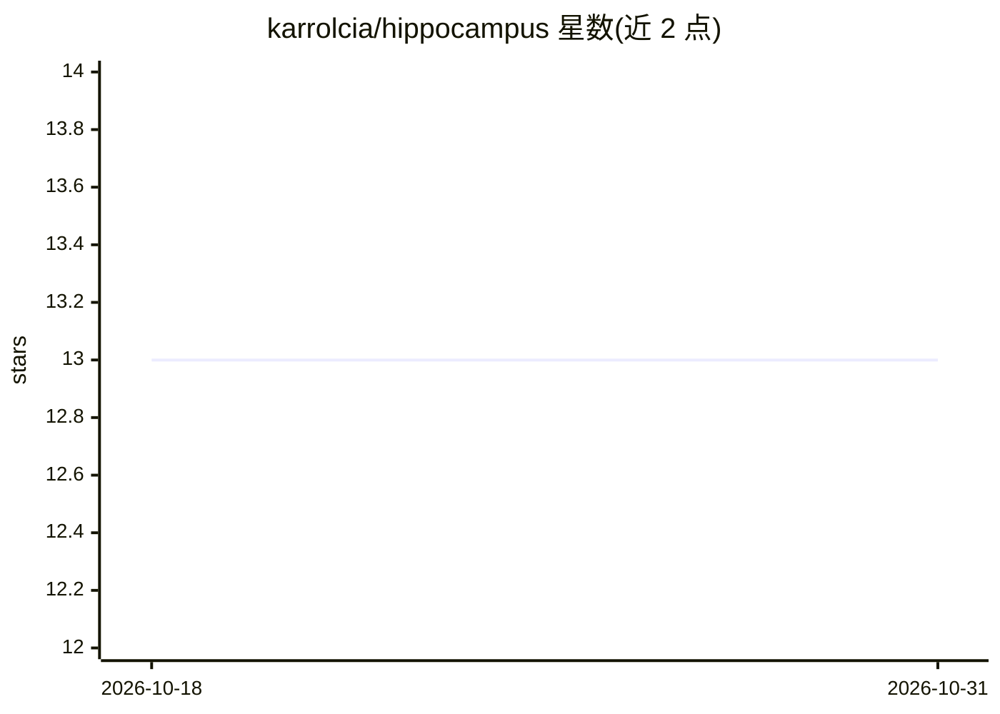

# karrolcia/hippocampus

⭐ 13 · TypeScript · AGPL-3.0 · 推送 2026-10-28 · [GitHub](https://github.com/karrolcia/hippocampus) · 个人维护

**自托管 MCP 记忆服务器：让各 AI 平台共享同一持久记忆**

开源的自托管远程 MCP 记忆服务器，通过 Streamable HTTP 暴露 remember、recall、forget 等 12 个记忆工具，任何支持 MCP 的 AI 客户端（Claude/ChatGPT/Gemini/Cursor 等）都可连接并共享同一记忆库。数据模型为知识图（实体/观察/关系），语义检索基于本地嵌入模型（约 80MB，首次运行自动下载），整库经 SQLCipher（AES-256）静态加密。部署方式覆盖 VPS+Docker、Fly.io、家庭服务器+Cloudflare Tunnel。

## 筛选速览

| 维度 | 判定 | 备注 |
|---|---|---|
| AI 角色 | `ai-ecosystem` | LLM/agent 周边工具 |
| 许可风险 | `viral` | AGPL-3.0 |
| 部署形态 | `self-host` | docker 或自建部署 |
| 模型依赖 | — | README 未给出锁定关系 |
| 硬件要求 | — | 无带数字的原话,不猜 |
| 安装摩擦 | `low` | 无编译、无系统依赖或容器化 |
| 成熟度 | — | 结构信号不足 |

## 能力要点

- 12 个记忆工具：remember/recall/forget/merge/consolidate/export 等
- 跨平台共享：Claude、ChatGPT、Gemini、Cursor、Perplexity 等经 MCP 连接同一记忆库
- SQLCipher（AES-256）整库加密，含嵌入向量
- 扩散激活检索与纯嵌入计算的矛盾检测，无需 LLM 调用

## 适用场景

- 让 Claude Code 里记录的项目决策在 ChatGPT、Gemini 中也能被召回
- 自建一个所有 AI 工具共用的加密长期记忆服务
- 整理与清理 AI 记忆：合并重复观察、检测矛盾、安全删除

## 场景标签

`Agent 记忆` · 领域:Agent 开发

## 证据(README 行号)

> L7: Hippocampus is an open-source, self-hosted MCP memory server. Deploy it once. Connect it to Claude, ChatGPT, Gemini,
> L29: MCP (Model Context Protocol) is the open standard every major AI platform has adopted. Hippocampus is a remote MCP 
> L31: Data model: knowledge graph with entities, observations, and relationships. Semantic search via local embeddings. E

## 星数曲线

2026-10-18 13 → 2026-10-31 13（+0）

---
*卡片 v1 · prompt 1.4 · 生成 2026-10-31 · 置信度 high · 依据 README sha `54a9ed7b6e31` · [字段定义](../../DATASET.md)*
