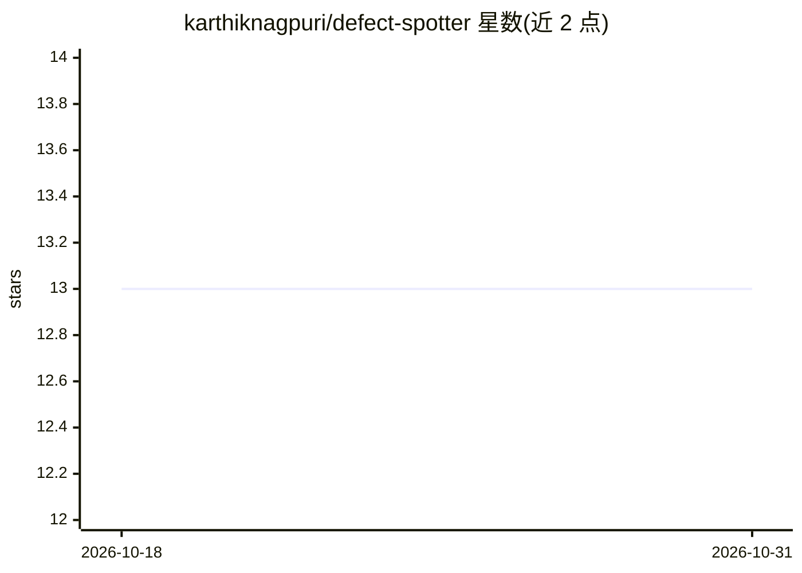

# karthiknagpuri/defect-spotter

⭐ 13 · TypeScript · MIT · 推送 2026-01-10 · [GitHub](https://github.com/karthiknagpuri/defect-spotter) · 个人维护

**房产缺陷与取证证据检测：用 Gemini 实时视觉检测并生成报告**

基于 React/TypeScript/Vite 的实时视觉检查 Web 应用：通过摄像头或屏幕捕获以 2 FPS 抽帧，调用 Google Gemini 2.0 Flash API 识别房产缺陷（裂缝、水损、霉菌、电气隐患等）与取证证据（物证、生物痕迹等），检测带边界框、置信度与严重度分级，经多帧时序一致性验证与 NMS 去重后输出确认结果，可导出含照片的 PDF 报告。需用户提供 Gemini API key（存于浏览器本地或 .env），Node.js 18+ 环境源码运行。

## 筛选速览

| 维度 | 判定 | 备注 |
|---|---|---|
| AI 角色 | `ai-native` | 本体是模型或模型工具 |
| 许可风险 | `permissive` | MIT |
| 部署形态 | `None` |  |
| 模型依赖 | — | README 未给出锁定关系 |
| 硬件要求 | — | 无带数字的原话,不猜 |
| 安装摩擦 | `low` | 无编译、无系统依赖或容器化 |
| 成熟度 | — | 结构信号不足 |

## 能力要点

- 摄像头/屏幕捕获实时检测，2 FPS 抽帧调用 Gemini 2.0 Flash
- 边界框、置信度评分与严重度分类
- 多帧时序一致性验证与 NMS 去重
- PDF 报告导出含证据照片与建议

## 适用场景

- 现场巡查时用摄像头实时识别房屋缺陷
- 犯罪/事故现场取证记录与证据编目
- 检查后一键生成带照片的检测报告

## 场景标签

`目标检测` · 领域:感知与多模态

## 证据(README 行号)

> L12: DefectSpotter is a real-time visual inspection system that uses Google's Gemini 2.0 Flash API to detect and documen
> L21: - AI-powered defect detection with bounding boxes

## 星数曲线

2026-10-18 13 → 2026-10-31 13（+0）

---
*卡片 v1 · prompt 1.4 · 生成 2026-10-31 · 置信度 high · 依据 README sha `dfd716115a6f` · [字段定义](../../DATASET.md)*
