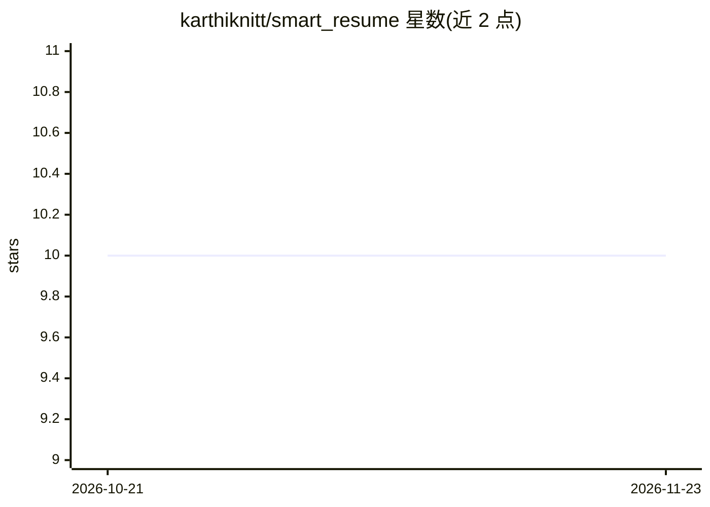

# karthiknitt/smart_resume

⭐ 10 · Shell · MIT · 推送 2026-08-14 · [GitHub](https://github.com/karthiknitt/smart_resume) · 个人维护

**给 Claude Code 用户：限流后自动等待并恢复会话**

一个围绕 Claude Code 命令行的 shell 包装工具：通过 statusline 钩子或后台轮询会话 JSONL 检测速率限制，向 Claude 进程发送 SIGINT 使其退出，读取重置时间戳并精确休眠后以 `claude --resume <uuid>` 恢复原会话，支持多次限流链式等待。提供 Linux/macOS/WSL 三个平台脚本，安装器自动检测 claude 二进制路径、注册 statusLine 钩子并向 shell 写入别名；依赖 jq（macOS 另需 python3），作者声明与 Anthropic 无官方关系。

## 筛选速览

| 维度 | 判定 | 备注 |
|---|---|---|
| AI 角色 | `ai-ecosystem` | LLM/agent 周边工具 |
| 许可风险 | `permissive` | MIT |
| 部署形态 | `desktop` | 安装包/桌面程序 |
| 模型依赖 | — | README 未给出锁定关系 |
| 硬件要求 | — | 无带数字的原话,不猜 |
| 安装摩擦 | `low` | 无编译、无系统依赖或容器化 |
| 成熟度 | — | 结构信号不足 |

## 能力要点

- statusline 钩子（90% 用量阈值）+ JSONL 轮询双通道检测限流
- 读取重置时间戳精确休眠后自动 `claude --resume`，支持链式等待
- 会话自动命名（rl-日期-目录格式），安装器幂等可重复运行
- Linux/macOS/WSL 三套平台脚本，macOS 用 python3 处理 BSD date 兼容

## 适用场景

- 长会话被速率限流打断后不想手动盯着重试
- 在 tmux 里挂机等待限流窗口重置后继续 Claude Code 会话
- 通过 shell 别名让日常 claude 命令默认带自动恢复能力

## 场景标签

 · 领域:开发工具/LLM 工作流自动化

## 证据(README 行号)

> L19: When Claude Code hits a rate limit, it exits mid-session. **Smart Resume** makes it
> L51: A shell wrapper around the real `claude` binary. It runs two tasks in parallel:
> L61: until then. It then resumes via `claude --resume <session-uuid>`.

## 星数曲线

2026-10-21 10 → 2026-11-23 10（+0）

---
*卡片 v1 · prompt 1.4 · 生成 2026-11-19 · 置信度 high · 依据 README sha `864c19e23660` · [字段定义](../../DATASET.md)*
