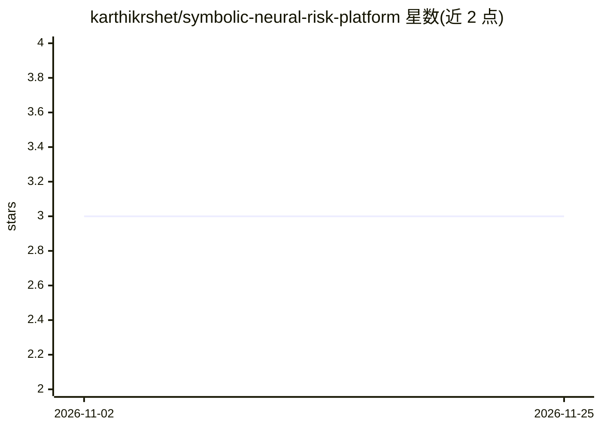

# karthikrshet/symbolic-neural-risk-platform

⭐ 3 · TypeScript · MIT · 推送 2026-10-16 · [GitHub](https://github.com/karthikrshet/symbolic-neural-risk-platform) · 个人维护

**神经符号混合风险评估与安全路线规划决策支持平台**

面向城市安全评估与风险感知路线规划的后端 API + 前端控制台系统：MLP 神经推理与确定性 AST 符号规则引擎耦合，五 agent 流水线（神经分析、符号推理、验证、决策融合、解释）对每次评估输出审计追踪与规则触发记录，符号规则在安全阈值触发时覆盖统计概率。集成 OSRM 计算带分段风险评分的驾驶/步行路线，含 RBAC、规则沙盒编辑器与基准对比看板。训练数据来自芝加哥开放数据门户的 4,954 条记录，提供 Docker Compose 与本地手动两种部署方式。

## 筛选速览

| 维度 | 判定 | 备注 |
|---|---|---|
| AI 角色 | `ai-native` | 本体是模型或模型工具 |
| 许可风险 | `permissive` | MIT |
| 部署形态 | `self-host` | docker 或自建部署 |
| 模型依赖 | — | README 未给出锁定关系 |
| 硬件要求 | — | 无带数字的原话,不猜 |
| 安装摩擦 | `low` | 无编译、无系统依赖或容器化 |
| 成熟度 | `idea` | |

## 能力要点

- 五 agent 共识流水线：神经推理、符号规则、验证、融合、解释
- AST 形式的确定性安全规则可在运行时增删与切换
- OSRM 集成生成带分段风险热力图的备选路线
- 基于芝加哥开放数据 744 条留出集的基准对比指标

## 适用场景

- 按区域属性输入评估风险等级并查看符号规则触发过程
- 规划避开高风险路段的驾驶/步行路线
- 为高风险场景维护可审计的确定性安全规则库

## 场景标签

`多智能体` · 领域:Agent 开发

## 证据(README 行号)

> L38: 1. **Neural Analysis Agent**: Executes Tabular Multi-Layer Perceptron (MLP) inference, computes softmax class proba
> L41: 4. **Decision Fusion Agent**: Executes a transparent arbitration policy (e.g., elevating risk to `CRITICAL` or `HIG
> L72: * **Predictive Safe Route Recommendation**: OpenStreetMap (OSRM) integration rendering alternative routes, segment 

## 星数曲线

2026-11-02 3 → 2026-11-25 3（+0）

---
*卡片 v1 · prompt 1.4 · 生成 2026-11-21 · 置信度 high · 依据 README sha `061afe253a93` · [字段定义](../../DATASET.md)*
