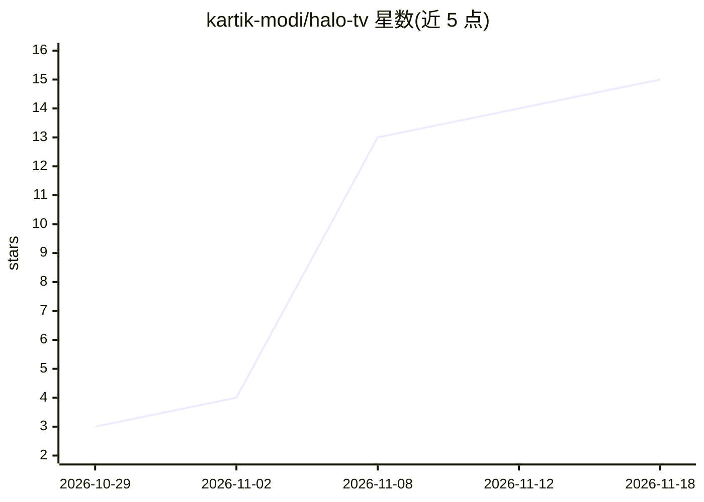

# kartik-modi/halo-tv

⭐ 15 · Java · NOASSERTION · 推送 2026-10-25 · [GitHub](https://github.com/kartik-modi/halo-tv) · 个人维护

**Android/Google/Fire TV 的替换桌面，含 AI 助手与跨平台影视聚合**

面向消费者的电视启动器，替换原生主页为三部分：液态玻璃风格 Home、常亮 Ambient 屏（时钟/天气/音乐/可对话 AI 助手 Jarvis）、以及 Tonight——基于 TMDB 聚合用户所订阅流媒体平台的影视内容并提供 AI 推荐。通过 Wi-Fi 用一条命令安装，或由 Claude Code/Codex/ChatGPT 等 AI coding agent 按 AGENTS.md 自动安装。需要 JDK 17 与 Android SDK 构建，TMDB 令牌必需，Anthropic/OpenAI key 为可选功能。

## 筛选速览

| 维度 | 判定 | 备注 |
|---|---|---|
| AI 角色 | `ai-enhanced` | 去掉 AI 部分产品仍成立 |
| 许可风险 | `none` | NOASSERTION |
| 部署形态 | `library` | 以包/库形式分发 |
| 模型依赖 | — | README 未给出锁定关系 |
| 硬件要求 | — | 无带数字的原话,不猜 |
| 安装摩擦 | `medium` | 含编译或系统依赖之一 |
| 成熟度 | — | 结构信号不足 |

## 能力要点

- 液态玻璃 Home 替换原生启动器（可回退）
- Ambient 常亮屏含 Jarvis AI 助手与手机 Web 控制端
- Tonight 聚合各国流媒体内容，AI 推荐记住口味
- 支持由 AI coding agent 一条提示完成安装

## 适用场景

- 替换电视自带广告主页为干净启动器
- 让电视常亮显示时钟天气并语音问天气/放歌
- 在一个入口浏览我订阅的各流媒体平台影视
- 用 Claude Code 等 AI 助手帮我自动完成安装

## 场景标签

`AI 助手` · 领域:对话与助手

## 证据(README 行号)

> L5: **A new OS for any Android TV, Google TV or Fire TV.** Halo TV replaces your TV's ad-filled home screen with three t
> L10: |**Ambient**|An always-on screen with a clock, sunrise/sunset, weather, air quality, a turntable music player and *
> L11: |**Tonight**|One place to find films and series across **your** streaming apps, in **your** country: Netflix, Prime

## 星数曲线

2026-10-29 3 → 2026-11-18 15（+12）

---
*卡片 v1 · prompt 1.4 · 生成 2026-11-18 · 置信度 mid · 依据 README sha `1e193afc0ac2` · [字段定义](../../DATASET.md)*
