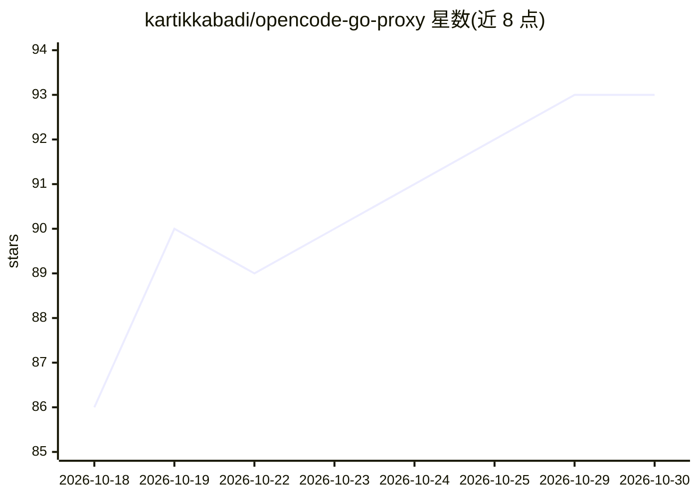

# kartikkabadi/opencode-go-proxy

⭐ 93 · Python · MIT · 推送 2026-10-15 · [GitHub](https://github.com/kartikkabadi/opencode-go-proxy) · [官网](https://opencode.ai/docs/go) · 个人维护

**让 Codex 应用调用 OpenCode Go 订阅模型的本地协议桥接代理**

单用户本地适配器：Codex 只说 Responses API，而 OpenCode Go 的 28 个文档化模型分属 Responses、Chat Completions、Anthropic Messages 三种上游协议，该代理在一个本地进程中按模型选择并翻译线协议，使 Codex 可直接使用这些模型；另支持 OpenCode Zen 按量付费网关（含 GPT/Claude/Gemini 等家族）。提供配置命令写入 Codex 的 config.toml 标记块，支持 SSE 流式转发、图像描述缓存（可用本地视觉运行时）、用量查看等。不提供共享账号或绕过限额，密钥仅用于 Go/Zen 上游请求。Python 3.11+，依赖 zstandard。

## 筛选速览

| 维度 | 判定 | 备注 |
|---|---|---|
| AI 角色 | `ai-ecosystem` | LLM/agent 周边工具 |
| 许可风险 | `permissive` | MIT |
| 部署形态 | `library` | 以包/库形式分发 |
| 模型依赖 | local-ok | 支持本地模型 |
| 硬件要求 | — | 无带数字的原话,不猜 |
| 安装摩擦 | `low` | 无编译、无系统依赖或容器化 |
| 成熟度 | — | 结构信号不足 |

## 能力要点

- 单进程内按模型路由并翻译 Responses / Chat Completions / Anthropic Messages 三种协议
- 28 个 OpenCode Go 文档化模型 + OpenCode Zen 按量网关（zen/<id>，含免费模型）
- config enable/disable 只管理 Codex config.toml 中的标记块，保留原有授权与会话
- 图像描述引擎可选本地运行时（Ollama/llama.cpp/LM Studio），带 30s 预算与字节级缓存

## 适用场景

- 在 Codex 应用中使用已订阅的 OpenCode Go 模型
- 通过 codex -m opencode-go/<id> 切换 GLM/DeepSeek/Kimi/MiniMax 等模型
- 让 Codex 走 OpenCode Zen 网关使用 Claude/Gemini 等按量计费模型
- 在菜单栏查看 Go 用量与限额（$60/月等）

## 场景标签

`模型网关` · 领域:Agent 开发

## 证据(README 行号)

> L12: Codex expects a Responses API (`/v1/responses`). OpenCode Go's documented
> L26: OpenCode Go Proxy is an independent, single-user local adapter. It is not an
> L106: |`POST /v1/responses`|all 28 documented models|translated to each model's certified Responses, Chat Completions, o

## 星数曲线

2026-10-18 86 → 2026-10-30 93（+7）

---
*卡片 v1 · prompt 1.4 · 生成 2026-10-23 · 置信度 mid · 依据 README sha `98561f78347f` · [字段定义](../../DATASET.md)*
