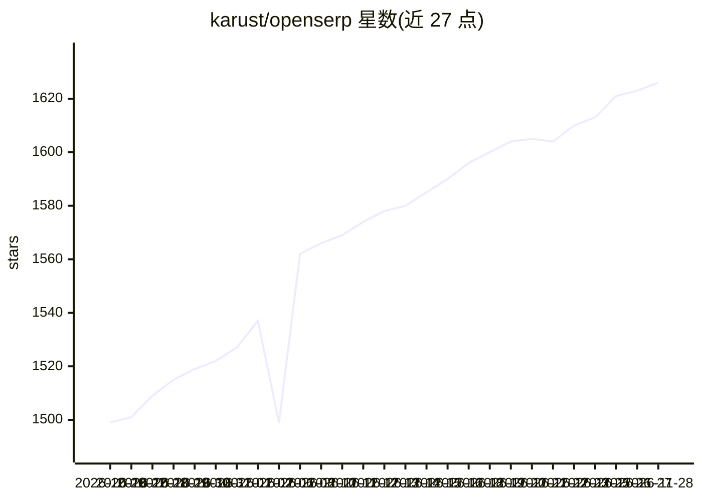

# karust/openserp

⭐ 1,626 · Go · MIT · 推送 2026-11-25 · [GitHub](https://github.com/karust/openserp) · [官网](https://openserp.org) · 个人维护

**自托管网页搜索 API/CLI：为 AI agent 与 SEO 返回结构化搜索结果**

以 Go 编写的自托管搜索服务，通过真实浏览器渲染 Google、Bing、Yandex、百度、DuckDuckGo、Ecosia 的搜索结果页，返回带来源引擎与排名的结构化 JSON，可将结果页读取为 Markdown（extract 参数、批量提取、死链以错误项返回）。提供 REST API、CLI、MCP server 及 Python/JS SDK，支持 Docker、二进制部署、HTTP/SOCKS5 代理、缓存、重试、限流与熔断，支持 UNIX socket 部署。无 API key 与按次计费；README 说明仍可能遇到 CAPTCHA 与限流。

## 筛选速览

| 维度 | 判定 | 备注 |
|---|---|---|
| AI 角色 | `ai-ecosystem` | LLM/agent 周边工具 |
| 许可风险 | `permissive` | MIT |
| 部署形态 | `desktop` | 安装包/桌面程序 |
| 模型依赖 | — | README 未给出锁定关系 |
| 硬件要求 | — | 无带数字的原话,不猜 |
| 安装摩擦 | `low` | 无编译、无系统依赖或容器化 |
| 成熟度 | — | 结构信号不足 |

## 能力要点

- 六引擎统一 JSON schema，多引擎合并保留来源与排名
- extract=N 一步完成搜索并读取页面 Markdown，批量最多 20 个 URL
- 提供 MCP server、Python/JS SDK、n8n 节点与 CLI
- 支持代理池、缓存、重试、限流、熔断与 UNIX socket

## 适用场景

- 给 Claude Code/Cursor 等 MCP 客户端接入自托管网络搜索
- 为 RAG 流程获取检索结果与页面 Markdown
- 做 SEO 排名监控与结果页追踪
- 从终端直接查询多引擎搜索结果

## 场景标签

`网页抓取` · 领域:效率与自动化

## 证据(README 行号)

> L12: OpenSERP is a **free self-hosted web search for AI agents and SEO.** REST API and CLI for Google, Bing, Yandex, Bai
> L14: No API keys, no per-search billing. It loads search results in browser and returns structured JSON with source engi
> L16: Works with Claude Code, Cursor, Codex, Claude Desktop and any MCP client, Open WebUI (built-in provider), n8n, and 

## 星数曲线

2026-10-26 1,499 → 2026-11-28 1,626（+127）

---
*卡片 v1 · prompt 1.4 · 生成 2026-11-26 · 置信度 high · 依据 README sha `1a90e17d457b` · [字段定义](../../DATASET.md)*
