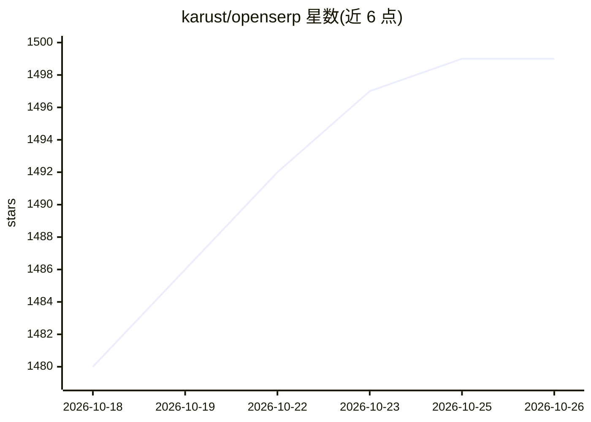

# karust/openserp

⭐ 1,499 · Go · MIT · 推送 2026-10-19 · [GitHub](https://github.com/karust/openserp) · [官网](https://openserp.org) · 个人维护

**自托管的 SERP 搜索 API 与 CLI，供 LLM/Agent 检索用**

用 Go 编写的开源 SERP API 服务器与命令行工具，通过浏览器渲染对 Google、Yandex、Baidu、Bing、DuckDuckGo、Ecosia 六个引擎执行搜索，返回统一 JSON/Markdown 等格式的结构化结果。提供多引擎合并去重的 Megasearch、目标页内容提取、图片搜索、代理与缓存等能力，配套 JS/Python SDK 与 MCP server 供 AI agent 接入。无 API key、按次计费，可通过 Docker、go install 或源码部署，另有同 API 的托管云版本。

## 筛选速览

| 维度 | 判定 | 备注 |
|---|---|---|
| AI 角色 | `ai-ecosystem` | LLM/agent 周边工具 |
| 许可风险 | `permissive` | MIT |
| 部署形态 | `self-host` | docker 或自建部署 |
| 模型依赖 | — | README 未给出锁定关系 |
| 硬件要求 | — | 无带数字的原话,不猜 |
| 安装摩擦 | `low` | 无编译、无系统依赖或容器化 |
| 成熟度 | — | 结构信号不足 |

## 能力要点

- 六个搜索引擎的专用端点，JSON 结构统一
- Megasearch 一次查询多引擎并去重合并
- URL 提取：搜索结果附带目标页 clean markdown
- 提供 MCP server（@openserp/mcp）供 AI agent 使用
- 支持 HTTP/SOCKS5 代理与预构建 Docker 镜像

## 适用场景

- 为 LLM 或 agent 提供自托管联网搜索后端
- SEO 关键词排名追踪，无需付费 SERP API
- 批量抓取搜索结果并提取页面内容做数据管道

## 场景标签

`网页抓取` · 领域:效率与自动化

## 证据(README 行号)

> L11: **OpenSERP** is a free, open-source SERP API and CLI for Google, Yandex, Baidu, Bing, DuckDuckGo, and Ecosia.
> L13: No API keys, no per-search billing: one command gives you live, structured search results on localhost - including 
> L80: |MCP server (AI agents)|`@openserp/mcp`|openserpapi/mcp|`npx @openserp/mcp`|

## 星数曲线

2026-10-18 1,480 → 2026-10-26 1,499（+19）

---
*卡片 v1 · prompt 1.4 · 生成 2026-10-21 · 置信度 mid · 依据 README sha `56fe6164b8ad` · [字段定义](../../DATASET.md)*
