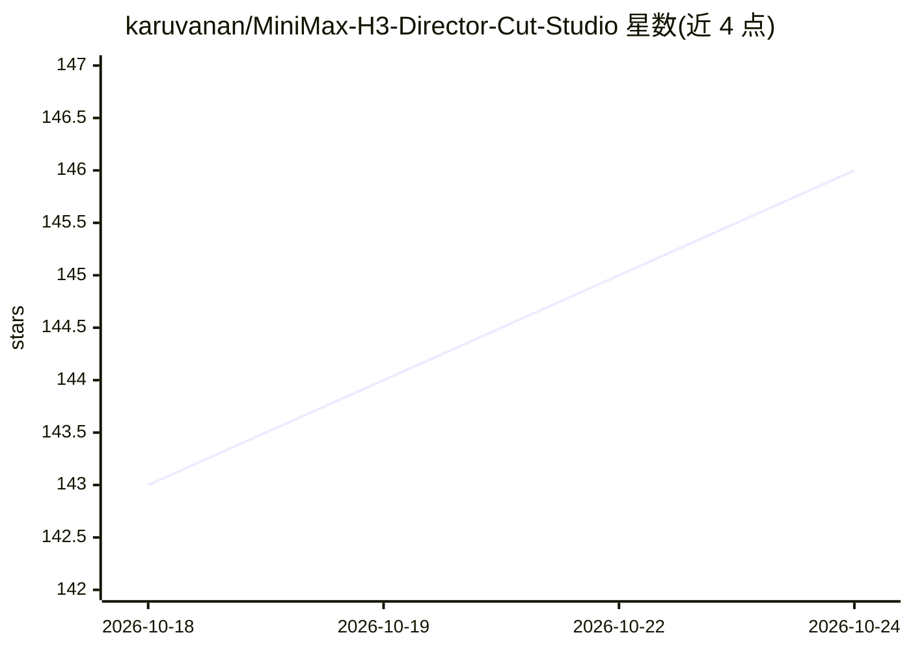

# karuvanan/MiniMax-H3-Director-Cut-Studio

⭐ 146 · Python · NOASSERTION · 推送 2026-10-19 · [GitHub](https://github.com/karuvanan/MiniMax-H3-Director-Cut-Studio) · [官网](https://www.youtube.com/@imbiplazaASUS) · 个人维护 · 中文 README

**面向 MiniMax H3 视频生成的本地 PySide6 导演剪辑工作台**

以 Adobe Premiere 剪辑逻辑为参考的本地桌面应用，管理图片/视频/音频素材，在多轨 Timeline 上规划 Shot、对白、Marker 与 Prompt，生成 MiniMax H3 Ref2VA 提示词，并把素材与参数提交到 ComfyUI 渲染长视频。附带 Z-Image 概念图生成、本地 BLIP/Whisper 素材描述与语音识别、LM Studio 文本模型连接、Qwen3-TTS/VoxCPM2、ACE-Step 音乐与人声分离的主机/副机部署模式。模型权重不随源码分发，需按清单自行准备；多角色换角采用 SAM3.1 双轮廓联合合成。当前版本 v0.3.8-alpha.2。

## 筛选速览

| 维度 | 判定 | 备注 |
|---|---|---|
| AI 角色 | `ai-native` | 本体是模型或模型工具 |
| 许可风险 | `none` | NOASSERTION |
| 部署形态 | `desktop` | 安装包/桌面程序 |
| 模型依赖 | — | README 未给出锁定关系 |
| 硬件要求 | — | 无带数字的原话,不猜 |
| 安装摩擦 | `medium` | 含编译或系统依赖之一 |
| 成熟度 | — | 结构信号不足 |

## 能力要点

- 多轨 Timeline 上规划 Shot/Dialogue/Prompt 并生成 H3 Ref2VA 提示词提交 ComfyUI
- SAM3.1 双轮廓联合合成的多角色 Character Swap（V1 Mask ∪ Generated Mask）
- 本地离线 BLIP 图片描述与 Whisper 语音识别，缺少权重不自动下载
- 音乐/TTS/人声分离组件支持主机-副机 Client Mode 局域网部署

## 适用场景

- 在类 Premiere 的多轨时间线上规划镜头并生成长视频
- 对源视频做指定演员的换角重制（Character Swap）
- 用 Design 页生成概念参考图并做语义素材增强

## 场景标签

`视频生成` `提示工程` · 领域:Agent 开发

## 证据(README 行号)

> L5: 一个以 Adobe Premiere Pro 剪辑逻辑为参考的本地 PySide6 导演工作台。它可以管理图片、视频和音频素材，在多轨 Timeline 上规划 Shot、Dialogue、Marker、Ending Hold 与 
> L75: |127|`UNETLoader`|`minimax_h3_ref2va_int8_convrot.safetensors`|`ComfyUI/models/diffusion_models/`|H3 Ref2VA 主扩散模型|是
> L156: |图片及视频抽帧描述|`Salesforce/blip-image-captioning-base`|`ai_libraries_common/models/models--Salesforce--blip-image-capt

## 星数曲线

2026-10-18 143 → 2026-10-24 146（+3）

---
*卡片 v1 · prompt 1.4 · 生成 2026-10-22 · 置信度 low · 依据 README sha `a1933938c7a6` · [字段定义](../../DATASET.md)*
