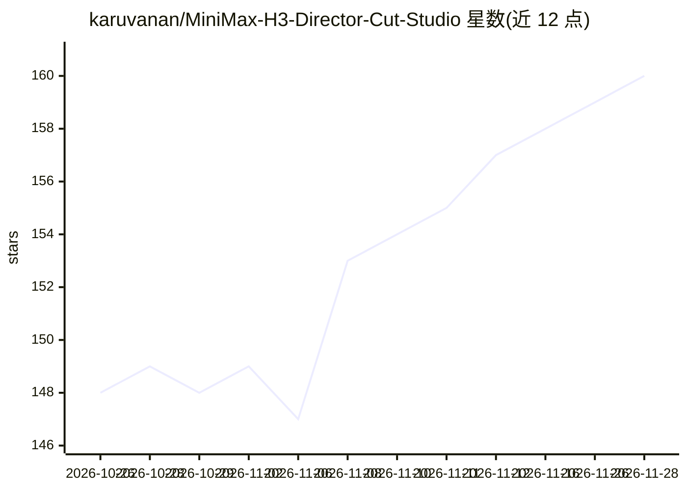

# karuvanan/MiniMax-H3-Director-Cut-Studio

⭐ 160 · Python · NOASSERTION · 推送 2026-11-11 · [GitHub](https://github.com/karuvanan/MiniMax-H3-Director-Cut-Studio) · [官网](https://www.youtube.com/@imbiplazaASUS) · 个人维护 · 中文 README

**面向 AI 视频创作者的本地导演工作台，生成 MiniMax H3 视频**

以 PySide6 构建的本地导演工作台，参考 Premiere 的多轨时间线逻辑：管理图片、视频、音频素材，在 Timeline 上规划 Shot、Dialogue、Marker 与 Prompt，生成 MiniMax H3 Ref2VA 提示词并提交 ComfyUI 渲染。集成 Z-Image 概念图生成、BLIP 自动 caption、Whisper 语音识别、LM Studio 文本模型接入，以及 ACE-Step 音乐、SoulX-Singer 歌声克隆、Kim_Vocal_2 人声分离等音频工作流，支持主机/副机 Client-Server 分工部署。模型权重不含在源码内，需用户自行下载放置，Windows 提供完整 runtime 包。

## 筛选速览

| 维度 | 判定 | 备注 |
|---|---|---|
| AI 角色 | `ai-native` | 本体是模型或模型工具 |
| 许可风险 | `none` | NOASSERTION |
| 部署形态 | `desktop` | 安装包/桌面程序 |
| 模型依赖 | — | README 未给出锁定关系 |
| 硬件要求 | `gpu-8g` | |
| 安装摩擦 | `medium` | 含编译或系统依赖之一 |
| 成熟度 | `idea` | |

## 能力要点

- 多轨 Timeline 规划 Shot/Prompt 并生成 MiniMax H3 Ref2VA 提示词，提交 ComfyUI 渲染
- Character-Swap LoRA 与 H3 Relay 工作流，支持逐帧人物识别（Qwen）与 SAM3.1 多角色联合遮罩
- 本地 BLIP 图片描述与 Whisper 语音识别（离线权重，不联网下载）
- 通过 OpenAI-compatible API 接入 LM Studio 文本模型，带 GPU 串行化调度（staged_model_driver）

## 适用场景

- 在时间线上分镜规划并生成长视频
- 对源视频做角色替换重制（Cast Remake）
- 本地生成概念参考图与配乐、歌声、人声分离

## 场景标签

`视频生成` `图像生成` `语音识别` · 领域:内容生成

## 证据(README 行号)

> L5: 一个以 Adobe Premiere Pro 剪辑逻辑为参考的本地 PySide6 导演工作台。它可以管理图片、视频和音频素材，在多轨 Timeline 上规划 Shot、Dialogue、Marker、Ending Hold 与 
> L67: ## 首次运行前必须准备的模型
> L169: Design 页面通过 OpenAI-compatible API 连接 LM Studio。公开配置建议先使用本机地址：

## 星数曲线

2026-10-26 148 → 2026-11-28 160（+12）

---
*卡片 v1 · prompt 1.4 · 生成 2026-11-27 · 置信度 mid · 依据 README sha `54f4dc139cc6` · [字段定义](../../DATASET.md)*
