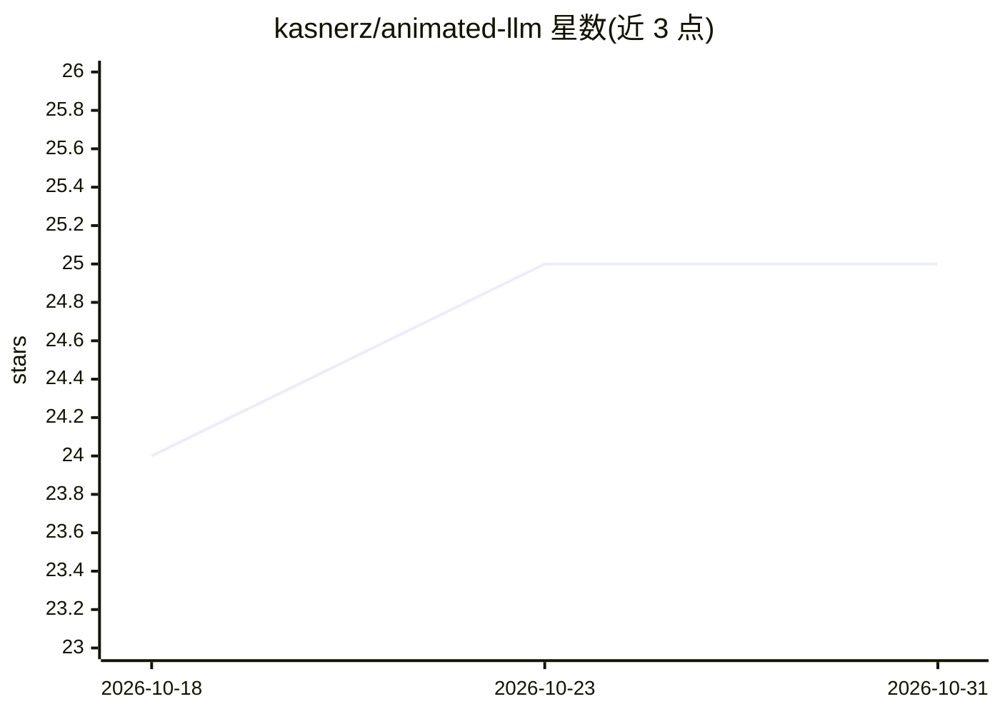

# kasnerz/animated-llm

⭐ 25 · JavaScript · MIT · 推送 2026-10-12 · [GitHub](https://github.com/kasnerz/animated-llm) · [官网](https://animatedllm.github.io) · 组织维护

**交互式可视化讲解 LLM 工作原理的教学网页应用**

基于 D3.js 和 GSAP 的教育类 Web 应用，通过动态分步动画展示 Transformer 架构的运行过程，替代静态图示或抽象公式。应用完全在浏览器中运行，使用预计算数据，无需后端。提供键盘控制（播放/暂停、逐步前进/后退、跳转到下一个 token、切换主题与语言等）。在线版本托管于 animatedllm.github.io；本地运行需 Node.js 20.9.0 以上与 npm，通过 npm install 和 npm run dev 启动。附 arXiv 论文可引用。

## 筛选速览

| 维度 | 判定 | 备注 |
|---|---|---|
| AI 角色 | `ai-knowledge` | 知识聚合/清单类 |
| 许可风险 | `permissive` | MIT |
| 部署形态 | `library` | 以包/库形式分发 |
| 模型依赖 | — | README 未给出锁定关系 |
| 硬件要求 | — | 无带数字的原话,不猜 |
| 安装摩擦 | `low` | 无编译、无系统依赖或容器化 |
| 成熟度 | — | 结构信号不足 |

## 能力要点

- 动态分步可视化 Transformer 架构运行过程
- 完全在浏览器中运行，使用预计算数据
- 键盘控制播放、步进、跳转 token 与主题/语言切换

## 适用场景

- 学生学习 LLM 与 Transformer 架构的教学辅助
- 课堂或讲座中演示语言模型逐步生成过程
- 自学研究者直观理解注意力等机制

## 场景标签

`教程课程` · 领域:学习与行业

## 证据(README 行号)

> L24: An educational web application designed to teach the how large language models (LLMs) work.
> L28: Instead of static diagrams or abstract equations, it provides a dynamic, step-by-step visualizations of the Transfo

## 星数曲线

2026-10-18 24 → 2026-10-31 25（+1）

---
*卡片 v1 · prompt 1.4 · 生成 2026-10-27 · 置信度 high · 依据 README sha `c8b33bfd6653` · [字段定义](../../DATASET.md)*
