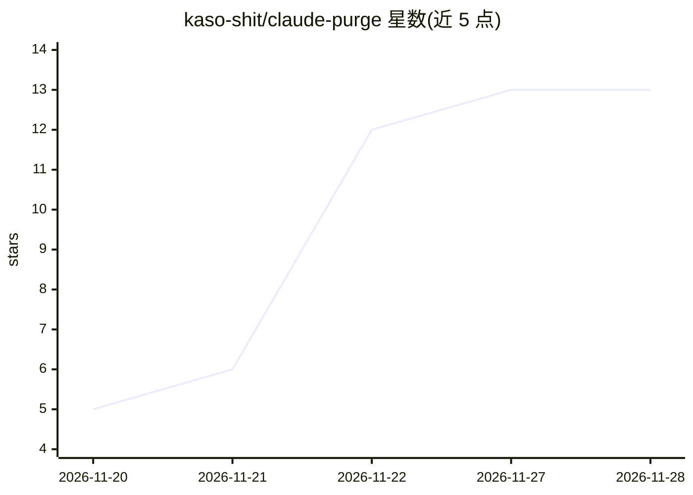

# kaso-shit/claude-purge

⭐ 13 · JavaScript · 推送 2026-11-18 · [GitHub](https://github.com/kaso-shit/claude-purge) · 个人维护 · 中文 README

**给个人学习者的 Claude Desktop 本地 harness 层补丁工具**

对本地 Claude Desktop 应用做四层补丁的工具集：应用提示词段替换、权限默认值修改、claude.exe CLI 二进制等长补丁、用户级环境变量注入系统提示，目的是让接入的模型按其配置的清单模式回答。机制包括内容特征定位（不写死版本号）、多副本全补、asar 重打包后哈希回填、--scan 自检与 --revert 回滚、备份文件还原。通过 Node.js 脚本运行，附 AI 代装教程；声明禁止商用、仅限个人学习研究，且不附带 Claude Desktop 软件本体。

## 筛选速览

| 维度 | 判定 | 备注 |
|---|---|---|
| AI 角色 | `ai-ecosystem` | LLM/agent 周边工具 |
| 许可风险 | `none` | — |
| 部署形态 | `desktop` | 安装包/桌面程序 |
| 模型依赖 | locked-api |  |
| 硬件要求 | — | 无带数字的原话,不猜 |
| 安装摩擦 | `low` | 无编译、无系统依赖或容器化 |
| 成熟度 | — | 结构信号不足 |

## 能力要点

- 四层补丁：提示词段、权限代码、CLI 二进制、环境变量注入
- 内容特征定位目标，版本漂移时 --scan 报告 no_target/no_match 并降级
- asar 重打包后在 claude.exe 中按值搜索并等长替换完整性哈希
- 幂等应用、.bak 备份与 --revert 一键还原

## 适用场景

- 在自己机器上有权修改的 Claude Desktop 副本上做逆向学习研究
- 用 --scan/--status 检查补丁在新版本上的命中状态
- 按部署教程交给能执行命令的 AI 完成安装流程

## 场景标签

`网络安全` · 领域:学习与行业

## 证据(README 行号)

> L5: > **Claude 桌面端 harness 层破甲引擎** — 在 **harness 层**（应用提示词 + 权限代码 + CLI 二进制 + 环境变量）做破甲，让**接入的模型**（**GLM / DeepSeek / Kim
> L9: `claude_purge` 对本地 Claude Desktop 应用做**提示词层 + 权限代码层 + CLI 层 + 环境层**四层补丁，用于本地安全研究与逆向学习。设计上**不写死版本**：通过内容特征在 `.vite/bu
> L77: AI 能自己处理：`npx @electron/asar` 解包/打包、`node bin/claude-purge.js --apply`、`asar-repack.mjs` 打包+哈希回填（含旧版 `.bak` 的固定位置兜底

## 星数曲线

2026-11-20 5 → 2026-11-28 13（+8）

---
*卡片 v1 · prompt 1.4 · 生成 2026-11-21 · 置信度 mid · 依据 README sha `b77049c81c39` · [字段定义](../../DATASET.md)*
