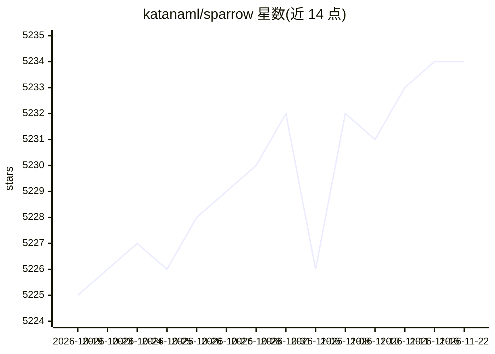

# katanaml/sparrow

⭐ 5,234 · Python · GPL-3.0 · 推送 2026-11-17 · [GitHub](https://github.com/katanaml/sparrow) · [官网](https://sparrow.katanaml.io) · 组织维护

**企业文档智能平台：从发票/报表提取结构化数据并提供 agent 工作流**

Sparrow 是 API-first 的企业文档智能平台：通过 REST API 将发票、收据、银行流水、表格等文档转换为经验证的 JSON 结构化数据，并提供指令调用与多 agent 工作流编排。采用可插拔 pipeline（Sparrow Parse 视觉 LLM、Sparrow Instructor 文本 LLM、Agents），后端可选 MLX（Apple Silicon）、vLLM（NVIDIA）、Ollama、Hugging Face、Mistral OCR。全部在本基础设施运行，无外部云依赖。附带 Web UI 与基于该平台的 Due Diligence 合规筛查 agent。许可证为 GPL v3，商业许可可用。

## 筛选速览

| 维度 | 判定 | 备注 |
|---|---|---|
| AI 角色 | `ai-native` | 本体是模型或模型工具 |
| 许可风险 | `viral` | GPL-3.0 |
| 部署形态 | `library` | 以包/库形式分发 |
| 模型依赖 | local-ok | 支持本地模型 |
| 硬件要求 | — | 无带数字的原话,不猜 |
| 安装摩擦 | `medium` | 含编译或系统依赖之一 |
| 成熟度 | — | 结构信号不足 |

## 能力要点

- REST API 提交文档返回验证的 JSON，含 Swagger 文档
- 可插拔 pipeline：Vision LLM、Text LLM、Agent 编排
- 多后端：MLX、vLLM、Ollama、Hugging Face、Mistral OCR
- 内置 Due Diligence agent 对接 VIES/GLEIF/OFAC 等筛查

## 适用场景

- 把发票和收据批量转成结构化 JSON 接入数据管道
- 在自有基础设施上部署文档提取 API 不走云端
- 上传供应商发票做公司身份与制裁名单筛查

## 场景标签

`多智能体` · 领域:Agent 开发

## 证据(README 行号)

> L11: Sparrow is an API-first platform for enterprise document intelligence. It combines accurate structured extraction f
> L22: Sparrow is an **API-first platform** built for enterprise document intelligence. It provides RESTful APIs for struc
> L28: - **Pluggable Pipelines**: Mix and match Vision LLM (Sparrow Parse), Text LLM (Sparrow Instructor), and Agent pipel

## 星数曲线

2026-10-19 5,225 → 2026-11-22 5,234（+9）

---
*卡片 v1 · prompt 1.4 · 生成 2026-11-22 · 置信度 high · 依据 README sha `16d5c9fbacd9` · [字段定义](../../DATASET.md)*
