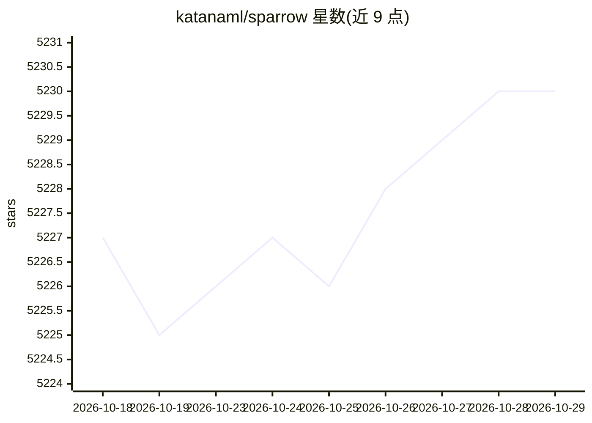

# katanaml/sparrow

⭐ 5,230 · Python · GPL-3.0 · 推送 2026-10-08 · [GitHub](https://github.com/katanaml/sparrow) · [官网](https://sparrow.katanaml.io) · 组织维护

**面向企业的文档结构化数据提取与 agent 工作流 API 平台**

API-first 的企业文档智能平台：通过 REST API 对发票、银行对账单、表格、表单、多页 PDF 等文档做 JSON schema 驱动的结构化提取，并提供指令推理（文本处理/校验/决策）与基于 Prefect 可视化监控的多步 agent 工作流编排。架构为可插拔管线：Sparrow Parse（Vision LLM）、Sparrow Instructor（Text LLM）、Agents、OCR 与 Web UI。后端支持 MLX、vLLM、Ollama、Hugging Face、Mistral OCR，统一 API 表面，全部运行在自有基础设施上。安装需 Python 3.12.10+ 与系统级 poppler 依赖，git clone 源码运行。

## 筛选速览

| 维度 | 判定 | 备注 |
|---|---|---|
| AI 角色 | `ai-native` | 本体是模型或模型工具 |
| 许可风险 | `viral` | GPL-3.0 |
| 部署形态 | `library` | 以包/库形式分发 |
| 模型依赖 | local-ok | 支持本地模型 |
| 硬件要求 | — | 无带数字的原话,不猜 |
| 安装摩擦 | `medium` | 含编译或系统依赖之一 |
| 成熟度 | — | 结构信号不足 |

## 能力要点

- REST API 提交文档并返回经 JSON schema 校验的结构化数据
- 可插拔管线：Vision LLM / Text LLM / Agent 混合搭配
- 多后端支持：MLX、vLLM、Ollama、Hugging Face、Mistral OCR，统一 API 表面
- 基于 Prefect 的多步 agent 工作流编排与可视化监控

## 适用场景

- 把发票、对账单、表单批量转为结构化 JSON 数据
- 在自有基础设施上构建文档智能数据管线，无外部 API 调用
- 通过指令推理 API 做文本处理、校验与决策
- 编排分类-提取-校验的多步文档处理工作流

## 场景标签

`文档解析` `工作流自动化` · 领域:效率与自动化

## 证据(README 行号)

> L9: **Structured data extraction, instruction calling and agentic workflows with ML, LLM and Vision LLM**
> L19: Production-ready structured data extraction powered by ML, LLMs & Vision LLMs.
> L25: - **Structured Extraction API**: Submit documents via REST and receive validated JSON — integrate directly into any

## 星数曲线

2026-10-18 5,227 → 2026-10-29 5,230（+3）

---
*卡片 v1 · prompt 1.4 · 生成 2026-10-20 · 置信度 high · 依据 README sha `a107024ca4e4` · [字段定义](../../DATASET.md)*
