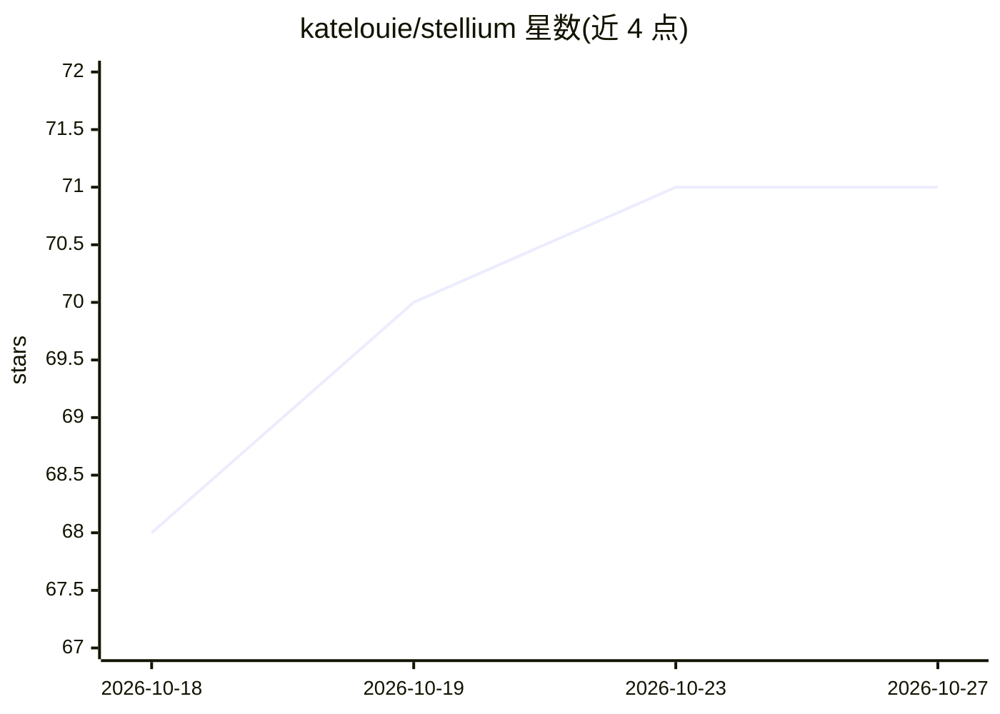

# katelouie/stellium

⭐ 71 · Python · AGPL-3.0 · 推送 2026-10-13 · [GitHub](https://github.com/katelouie/stellium) · [官网](https://stelliumastro.app) · 个人维护 · 中文 README

**Python 占星计算库：星盘计算、可视化与报告生成**

基于 Swiss Ephemeris 的计算占星学 Python 库，面向开发者和占星师。提供本命盘、合盘/行运/推进等多轮盘计算、17 种宫位制、25+ 阿拉伯点、卜卦择时、吠陀（南北印度盘）与八字（十神藏干）等中西体系，输出 SVG/PDF/PNG 图表及多语言（含简体中文）报告；附 CLI、名人星盘数据库与 pandas 批量分析。单盘构建约 0.2ms，位置经 NASA JPL Horizons 交叉核验（小行星误差 2 弧秒内）。支持 chart.to_prompt_text() 生成适配 LLM 提示的 Markdown 文本。需 Python 3.11+，3.12+ 安装依赖需 C 工具链。

## 筛选速览

| 维度 | 判定 | 备注 |
|---|---|---|
| AI 角色 | `ai-enhanced` | 去掉 AI 部分产品仍成立 |
| 许可风险 | `viral` | AGPL-3.0 |
| 部署形态 | `library` | 以包/库形式分发 |
| 模型依赖 | — | README 未给出锁定关系 |
| 硬件要求 | — | 无带数字的原话,不猜 |
| 安装摩擦 | `low` | 无编译、无系统依赖或容器化 |
| 成熟度 | — | 结构信号不足 |

## 能力要点

- 西方/吠陀/八字多体系星盘计算，17 种宫位制
- SVG/PDF/PNG 图表输出，字体打包保证跨平台一致
- to_prompt_text() 生成适配 LLM 提示的 Markdown 导出
- CLI 快速出图与名人出生数据库、pandas 批量分析

## 适用场景

- 用脚本批量计算与分析大量本命盘数据
- 生成合盘、行运时间线等对比星盘及报告
- 为 LLM 应用输出结构化的星盘文本

## 场景标签

 · 领域:占星/天文计算

## 证据(README 行号)

> L61: - **Prompt-friendly text export** - `chart.to_prompt_text()` generates clean markdown from any chart type, ready fo
> L14: Built on Swiss Ephemeris for NASA-grade astronomical accuracy, Stellium brings professional astrological calculatio

## 星数曲线

2026-10-18 68 → 2026-10-27 71（+3）

---
*卡片 v1 · prompt 1.4 · 生成 2026-10-24 · 置信度 mid · 依据 README sha `1d60977efc5f` · [字段定义](../../DATASET.md)*
