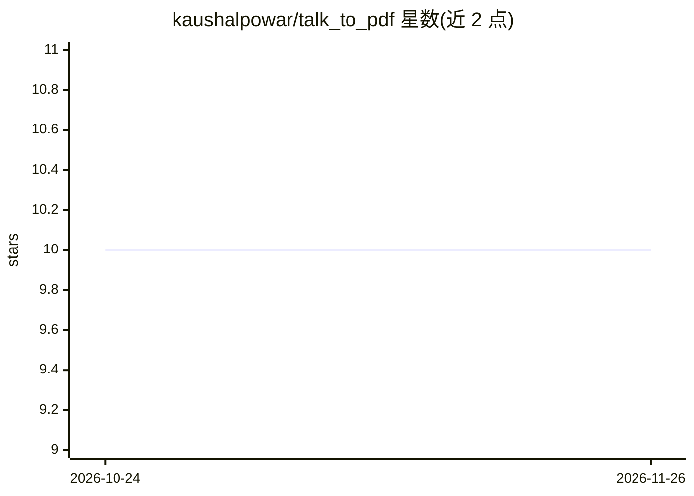

# kaushalpowar/talk_to_pdf

⭐ 10 · Python · MIT · 推送 2026-01-19 · [GitHub](https://github.com/kaushalpowar/talk_to_pdf) · [官网](https://talk-to-pdf.streamlit.app/) · 个人维护

**基于 Streamlit 的 PDF 自然语言问答应用**

多页 Streamlit 应用，分 API Key 配置、PDF 上传处理、聊天问答三个模块。上传 PDF 后经 LlamaIndex 建立向量索引，通过 CondenseQuestionChatEngine 维护对话上下文并生成流式回答；用户需自行输入 OpenAI API Key，可在 gpt-3.5-turbo 与 gpt-4 间选择并调节 temperature 参数。README 未给出依赖安装或运行命令说明，仅描述架构与实现细节。

## 筛选速览

| 维度 | 判定 | 备注 |
|---|---|---|
| AI 角色 | `ai-native` | 本体是模型或模型工具 |
| 许可风险 | `permissive` | MIT |
| 部署形态 | `library` | 以包/库形式分发 |
| 模型依赖 | — | README 未给出锁定关系 |
| 硬件要求 | — | 无带数字的原话,不猜 |
| 安装摩擦 | `low` | 无编译、无系统依赖或容器化 |
| 成熟度 | — | 结构信号不足 |

## 能力要点

- LlamaIndex 向量索引与上下文感知聊天引擎
- 流式 token 输出的实时响应
- 模型选择（gpt-3.5-turbo/gpt-4）与 temperature 可调
- Streamlit session state 管理多页状态

## 适用场景

- 用自然语言提问代替翻找 PDF 内容
- 多份 PDF 上传后建立可查询索引
- 学习 LlamaIndex 与 Streamlit 组合的示例工程

## 场景标签

`文档问答` · 领域:知识与检索

## 证据(README 行号)

> L7: Talk to PDF is an innovative web application that enables natural language interaction with PDF documents through an
> L14: The system processes uploaded PDFs through a sophisticated pipeline that includes document indexing, vector storage
> L123: The Talk to PDF application implements a modern, modular architecture built on the Streamlit framework, leveraging

## 星数曲线

2026-10-24 10 → 2026-11-26 10（+0）

---
*卡片 v1 · prompt 1.4 · 生成 2026-11-19 · 置信度 high · 依据 README sha `010210f75880` · [字段定义](../../DATASET.md)*
