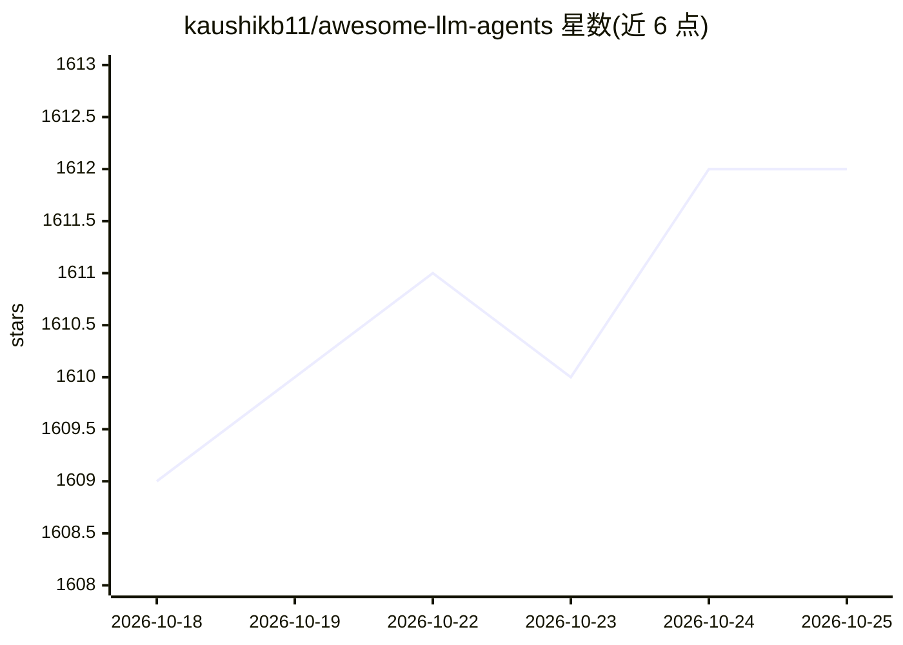

# kaushikb11/awesome-llm-agents

⭐ 1,612 · Python · CC0-1.0 · 推送 2026-10-18 · [GitHub](https://github.com/kaushikb11/awesome-llm-agents) · 个人维护

**LLM agent 框架策展清单：按类别收录开源框架与工具**

收录开源 LLM agent 框架、运行时与工具的策展清单，按核心框架、多智能体编排、CLI Agent 工具、低代码构建器、检索与数据、记忆与上下文、安全评测、领域专用、研究实验、2023 自主智能体浪潮及不活跃项目等约 12 个类别组织。每个条目列出星标数、语言、许可证与更新时间，指标每周刷新（当前标注 2026-10-18）。条目数据存放于 data/frameworks/，README 由其生成，新增项目通过 CONTRIBUTING.md 提交。

## 筛选速览

| 维度 | 判定 | 备注 |
|---|---|---|
| AI 角色 | `ai-knowledge` | 知识聚合/清单类 |
| 许可风险 | `viral` | CC0-1.0 |
| 部署形态 | `None` |  |
| 模型依赖 | — | README 未给出锁定关系 |
| 硬件要求 | — | 无带数字的原话,不猜 |
| 安装摩擦 | `low` | 无编译、无系统依赖或容器化 |
| 成熟度 | — | 结构信号不足 |

## 能力要点

- 约 12 个类别组织百余个开源 agent 框架与工具条目
- 每条含星标数、语言、许可证、更新时间，指标每周刷新
- 单独维护 Inactive 分区，标注归档或超过 12 个月未更新的项目
- 条目数据存于 data/frameworks/，README 自动生成，支持社区贡献

## 适用场景

- 选型时按类别浏览和比较 LLM agent 框架
- 了解哪些 agent 项目已归档或停止维护
- 跟踪 agent 生态中记忆、安全评测等细分方向的工具

## 场景标签

`精选清单` · 领域:学习与行业

## 证据(README 行号)

> L3: A curated list of open-source frameworks, runtimes and tooling for building LLM
> L6: To suggest a project, see CONTRIBUTING.md — entries live in

## 星数曲线

2026-10-18 1,609 → 2026-10-25 1,612（+3）

---
*卡片 v1 · prompt 1.4 · 生成 2026-10-21 · 置信度 high · 依据 README sha `d34dfecc9343` · [字段定义](../../DATASET.md)*
