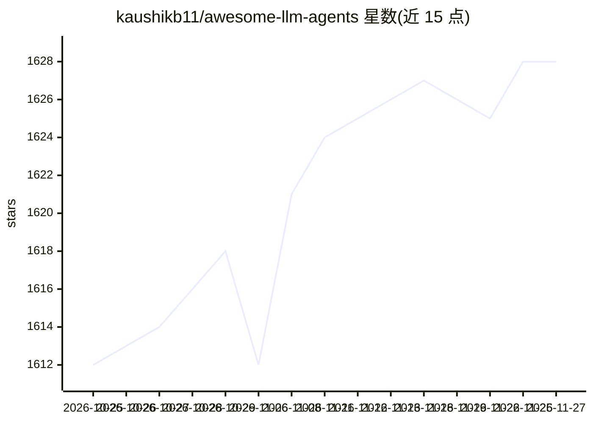

# kaushikb11/awesome-llm-agents

⭐ 1,628 · Python · CC0-1.0 · 推送 2026-11-22 · [GitHub](https://github.com/kaushikb11/awesome-llm-agents) · 个人维护

**LLM Agent 框架策展清单：按类别组织、每周更新指标**

开源 LLM agent 框架、运行时与工具的聚合清单，内容按核心框架、多智能体编排、CLI agent 工具、低代码构建器、检索与数据、记忆与上下文、基础设施、安全评估、领域 agent、研究实验等分类组织，每个条目列出 Stars、语言、许可证与更新时间，指标每周刷新。条目数据存放于 data/frameworks/，README 由其生成，收录通过 CONTRIBUTING.md 提交；另设 Inactive 区标注已归档或长期未更新的项目。清单本身以 CC0 1.0 许可发布。

## 筛选速览

| 维度 | 判定 | 备注 |
|---|---|---|
| AI 角色 | `ai-knowledge` | 知识聚合/清单类 |
| 许可风险 | `viral` | CC0-1.0 |
| 部署形态 | `None` |  |
| 模型依赖 | — | README 未给出锁定关系 |
| 硬件要求 | — | 无带数字的原话,不猜 |
| 安装摩擦 | `low` | 无编译、无系统依赖或容器化 |
| 成熟度 | — | 结构信号不足 |

## 能力要点

- 按 10+ 类别组织的 agent 框架清单，每条目含 Stars/语言/许可证/更新时间
- 指标每周刷新，标注已归档与 2023 wave 自主 agent 的现状
- 条目存于 data/frameworks/，README 由数据自动生成
- 设 Inactive 专区说明被广泛引用但不再活跃的项目状态

## 适用场景

- 为构建 LLM agent 选型时浏览可用的框架与运行时
- 按类别查找多智能体编排、记忆层或安全评估工具
- 了解 2023 年自主 agent 项目的当前维护状态

## 场景标签

`精选清单` · 领域:学习与行业

## 证据(README 行号)

> L3: A curated list of open-source frameworks, runtimes and tooling for building LLM
> L11: ## Core Frameworks

## 星数曲线

2026-10-25 1,612 → 2026-11-27 1,628（+16）

---
*卡片 v1 · prompt 1.4 · 生成 2026-11-23 · 置信度 high · 依据 README sha `a3d7c2eab4b2` · [字段定义](../../DATASET.md)*
