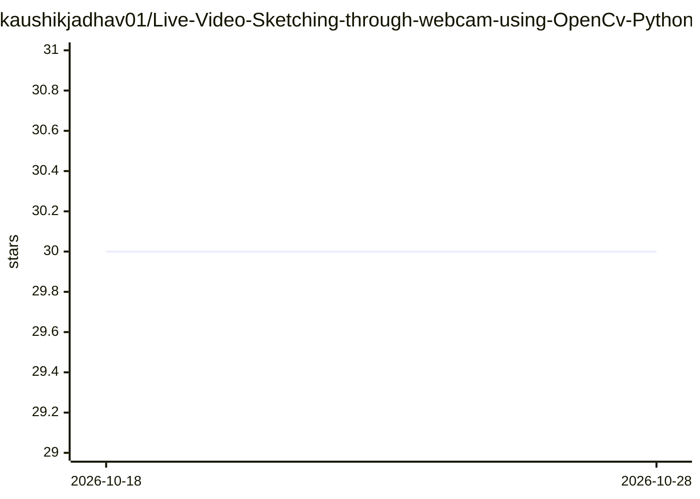

# kaushikjadhav01/Live-Video-Sketching-through-webcam-using-OpenCv-Python

⭐ 30 · Jupyter Notebook · 推送 2026-06-16 · [GitHub](https://github.com/kaushikjadhav01/Live-Video-Sketching-through-webcam-using-OpenCv-Python) · 个人维护

**用 OpenCV 将摄像头实时视频转为素描画面的 Python 项目**

基于 Python 的计算机视觉应用：读取摄像头实时视频流，对每一帧做素描化处理并实时显示。技术栈为 OpenCV 处理图像、NumPy 参与运算、Keras 与 Matplotlib 用于优化性能及海报化帧。以仓库源码加 Jupyter Notebook 形式提供，安装需 Python 环境、下载仓库并 pip 安装 requirements.txt。README 提示效果因摄像头而异，可调整 canny_edges 与 binarize 参数适配。

## 筛选速览

| 维度 | 判定 | 备注 |
|---|---|---|
| AI 角色 | `ai-native` | 本体是模型或模型工具 |
| 许可风险 | `none` | — |
| 部署形态 | `library` | 以包/库形式分发 |
| 模型依赖 | — | README 未给出锁定关系 |
| 硬件要求 | — | 无带数字的原话,不猜 |
| 安装摩擦 | `low` | 无编译、无系统依赖或容器化 |
| 成熟度 | — | 结构信号不足 |

## 能力要点

- 摄像头视频流的实时逐帧素描化
- 基于 OpenCV，配合 Keras/NumPy 做性能优化与海报化
- 提供 Jupyter Notebook 运行方式
- canny_edges 与 binarize 参数可按摄像头调整

## 适用场景

- 把摄像头画面实时转为素描风格视频
- 学习 OpenCV 边缘检测与二值化处理的教学示例

## 场景标签

`图像视频处理` · 领域:感知与多模态

## 证据(README 行号)

> L2:  Computer Vision model creates a live video sketch of frames through real time web cam video. Source code is written
> L17:  On command prompt, run pip install -r requirements.txt

## 星数曲线

2026-10-18 30 → 2026-10-28 30（+0）

---
*卡片 v1 · prompt 1.4 · 生成 2026-10-26 · 置信度 mid · 依据 README sha `336b85793063` · [字段定义](../../DATASET.md)*
