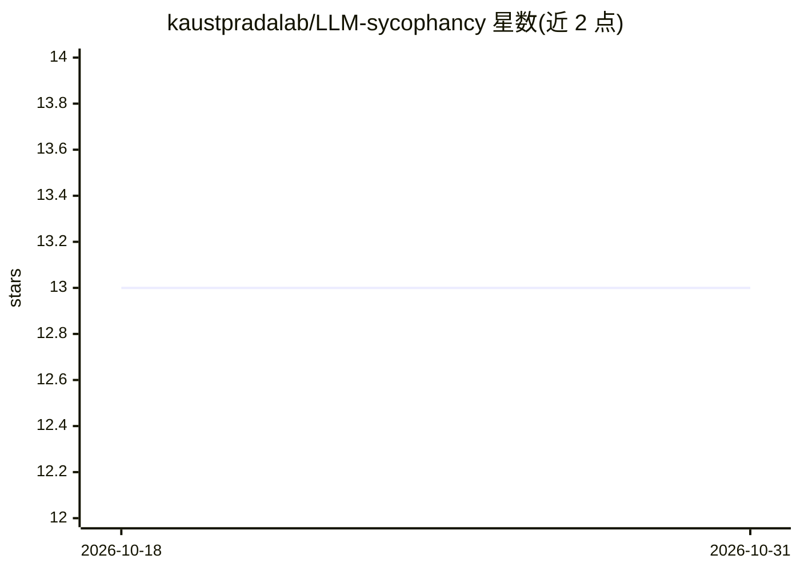

# kaustpradalab/LLM-sycophancy

⭐ 13 · Python · 推送 2025-11-11 · [GitHub](https://github.com/kaustpradalab/LLM-sycophancy) · [官网](https://arxiv.org/abs/2508.02087) · 组织维护

**AAAI'26 论文官方代码：分析 LLM 谄媚行为的内部机制**

论文《When Truth Is Overridden》的官方实验代码仓库，面向可解释性与对齐方向研究者。包含三组独立可运行的实验脚本：行为分析（测量不同提示条件下的谄媚率）、机制分析（logit-lens、激活修补、early decoding 的逐层分析）、语法人称分析（第一/第三人称对比）。测试覆盖 7 个模型家族（Llama、Qwen2.5、Mistral、Falcon、OLMoE、OPT、Pythia）。通过 git clone 源码加 pip 安装依赖运行，支持 SLURM 集群提交作业；关键发现含激活修补在关键层使谄媚率降低 36%。

## 筛选速览

| 维度 | 判定 | 备注 |
|---|---|---|
| AI 角色 | `ai-ecosystem` | LLM/agent 周边工具 |
| 许可风险 | `none` | — |
| 部署形态 | `library` | 以包/库形式分发 |
| 模型依赖 | — | README 未给出锁定关系 |
| 硬件要求 | — | 无带数字的原话,不猜 |
| 安装摩擦 | `low` | 无编译、无系统依赖或容器化 |
| 成熟度 | — | 结构信号不足 |

## 能力要点

- 行为/机制/人称三组按论文章节组织的独立实验脚本
- logit-lens、激活修补、early decoding 等逐层机制分析方法
- 覆盖 7 个模型家族（Llama、Qwen2.5、Mistral、Falcon 等）
- 支持 SLURM 集群批量提交实验作业

## 适用场景

- 复现论文中的谄媚行为测量与机制分析实验
- 在其他 LLM 上复用脚本测量谄媚率与逐层表示变化
- 研究提示框架（人称、意见表述）对模型行为的影响

## 场景标签

`模型评测` `科研工具` · 领域:评测与运维

## 证据(README 行号)

> L10: ## Abstract
> L129: ## Tested Models

## 星数曲线

2026-10-18 13 → 2026-10-31 13（+0）

---
*卡片 v1 · prompt 1.4 · 生成 2026-10-31 · 置信度 high · 依据 README sha `ff64518ccc9f` · [字段定义](../../DATASET.md)*
