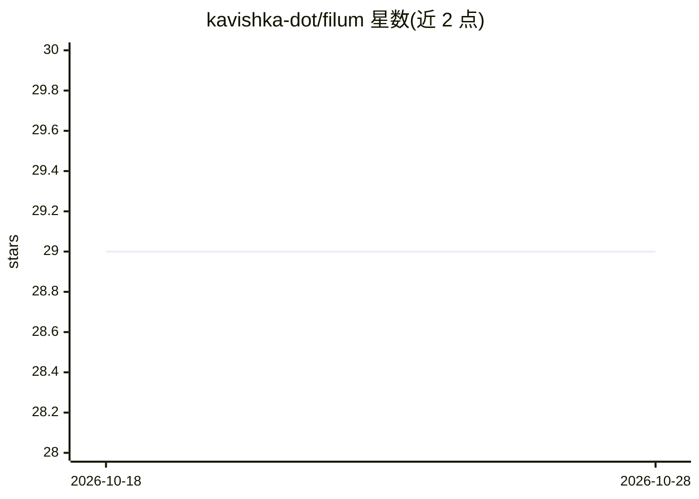

# kavishka-dot/filum

⭐ 29 · C · 推送 2026-05-10 · [GitHub](https://github.com/kavishka-dot/filum) · 个人维护

**面向 MCU 边缘设备的纯 C99 LoRa 联邦学习库**

纯 C99 编写的微控制器联邦学习库：Shard 运行于 STM32（F411/F103），在本地传感器数据上训练并发送 Q8 稀疏梯度；Herald 运行于 Linux 或树莓派，协调训练轮次并聚合更新回传全局模型。关键机制包括 top-k + Q8 量化（约 5.5 倍压缩）、FedAvg/FedProx/中位数聚合、每分片高斯差分隐私（含预算跟踪）、Curve25519+ChaCha20-Poly1305 加密。无堆分配、无 Python 运行时，设计在 128 KB RAM 内运行；密码实现未经独立审计，需用户自行填充 HAL 存根方可烧录。

## 筛选速览

| 维度 | 判定 | 备注 |
|---|---|---|
| AI 角色 | `ai-ecosystem` | LLM/agent 周边工具 |
| 许可风险 | `permissive` | — |
| 部署形态 | `None` |  |
| 模型依赖 | — | README 未给出锁定关系 |
| 硬件要求 | — | 无带数字的原话,不猜 |
| 安装摩擦 | `medium` | 含编译或系统依赖之一 |
| 成熟度 | — | 结构信号不足 |

## 能力要点

- 纯 C99、零动态分配，128 KB RAM 预算内运行
- Q8 top-k 稀疏梯度，约 5.5 倍压缩，SF7-SF12 LoRa 线格式
- FedAvg/FedProx/中位数聚合与 (ε,δ)-DP 预算跟踪
- X25519 密钥交换 + ChaCha20-Poly1305 认证加密

## 适用场景

- 在 STM32 + SX1276 节点上做无需上传原始数据的本地训练
- Linux/树莓派侧部署 Herald 协调多分片联邦训练轮次
- 无硬件时在主机内存中跑端到端联邦学习演示与测试

## 场景标签

`模型训练` · 领域:训练与推理

## 证据(README 行号)

> L14: Filum is a pure C99 library for on-device federated learning on microcontrollers that communicate over LoRa radio. 
> L26: - **Federated aggregation:** FedAvg, FedProx, and coordinate-wise median aggregation for Byzantine robustness

## 星数曲线

2026-10-18 29 → 2026-10-28 29（+0）

---
*卡片 v1 · prompt 1.4 · 生成 2026-10-26 · 置信度 high · 依据 README sha `4094cca661a0` · [字段定义](../../DATASET.md)*
