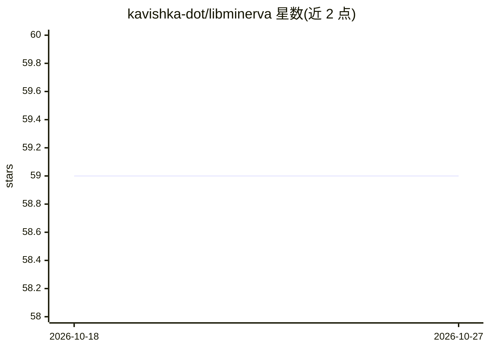

# kavishka-dot/libminerva

⭐ 59 · C · 推送 2026-05-13 · [GitHub](https://github.com/kavishka-dot/libminerva) · 个人维护

**面向 MCU 的加密验证神经网络推理库，最小支持 ATmega328P**

纯 C 编写的微控制器端 ML 推理库：在 ATtiny85 到 STM32 及主机平台上运行加密、经完整性校验的神经网络（MLP/1D CNN/BNN，Q8/Q4/二值量化），使用 ChaCha20-256 权重加密、BLAKE2s keyed MAC、常数时间执行、防篡改 canary 与输出会话 MAC，零动态分配。附带 Python 编译器将 float 模型转换为加密 C 数组。v1.2 修复了 MAC 验证完全失效、int16 累加器溢出等多个关键缺陷；已知限制包括偏置独立量化可能扭曲输出层、输出总线明文可读。

## 筛选速览

| 维度 | 判定 | 备注 |
|---|---|---|
| AI 角色 | `ai-ecosystem` | LLM/agent 周边工具 |
| 许可风险 | `none` | — |
| 部署形态 | `None` |  |
| 模型依赖 | — | README 未给出锁定关系 |
| 硬件要求 | — | 无带数字的原话,不猜 |
| 安装摩擦 | `medium` | 含编译或系统依赖之一 |
| 成熟度 | — | 结构信号不足 |

## 能力要点

- 加密+完整性校验的神经网络推理，常数时间执行与反故障注入 canary
- 最小目标 ATmega328P：3 层 MLP 约 14.5 KB flash、~28 ms/次推理
- 支持 MLP/1D CNN/BNN 与 Q8/Q4/二值量化，零动态分配
- Python 编译器将 float 模型生成为加密 C 数组

## 适用场景

- 在 AVR/STM32 微控制器上部署带模型保密与防篡改需求的推理
- IoT 传感设备上运行轻量分类模型
- 对固件体积与 RAM 严格受限的 tinyML 场景做安全推理

## 场景标签

`推理引擎` · 领域:训练与推理

## 证据(README 行号)

> L22: Minerva is a pure C ML inference library for microcontrollers, from ATtiny85 to
> L23: STM32, with military-grade security properties. It runs encrypted,
> L56: |**Targets**|ATtiny85, ATmega328P, ATmega2560, STM32F0/F4, Host|

## 星数曲线

2026-10-18 59 → 2026-10-27 59（+0）

---
*卡片 v1 · prompt 1.4 · 生成 2026-10-24 · 置信度 high · 依据 README sha `bdee82fce2c5` · [字段定义](../../DATASET.md)*
