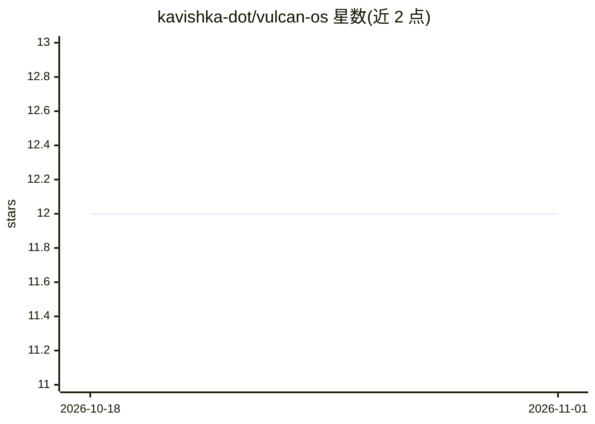

# kavishka-dot/vulcan-os

⭐ 12 · C · 推送 2026-05-14 · [GitHub](https://github.com/kavishka-dot/vulcan-os) · 个人维护

**面向 STM32H7 边缘 ML 推理与训练的自研实时操作系统**

从零编写的 Cortex-M7 裸机实时操作系统，不依赖 FreeRTOS、STM32 HAL 与 TFLite。已完成抢占式调度内核、内存池分配器、tensor arena、互斥锁，以及 SysClock 480 MHz、UART、GPIO、DMA、ADC、SPI 的 HAL；ML 算子（INT8 matmul、conv2d 等）、模型加载器与片上训练引擎（SGD/Adam、微反向传播）列为后续计划。面向嵌入式开发者，需 arm-none-eabi-gcc 工具链从源码构建，目标板为 Nucleo-H743ZI2。

## 筛选速览

| 维度 | 判定 | 备注 |
|---|---|---|
| AI 角色 | `ai-ecosystem` | LLM/agent 周边工具 |
| 许可风险 | `none` | — |
| 部署形态 | `None` |  |
| 模型依赖 | — | README 未给出锁定关系 |
| 硬件要求 | — | 无带数字的原话,不猜 |
| 安装摩擦 | `medium` | 含编译或系统依赖之一 |
| 成熟度 | `idea` | |

## 能力要点

- 自研内核：抢占式调度、内存池分配器、tensor arena、互斥锁
- 不使用 FreeRTOS / STM32 HAL / TFLite
- 已完成 ADC 连续 DMA、SPI、UART 等 HAL（Phase 2）
- 规划 INT8 算子、模型加载器与片上训练引擎（Phase 3-5）

## 适用场景

- 在 STM32H7 上以自研 RTOS 运行 INT8 推理
- 片上训练与微反向传播的实验平台（规划中）
- 学习 Cortex-M7 裸机内核与 HAL 实现

## 场景标签

`推理引擎` · 领域:训练与推理

## 证据(README 行号)

> L5: A minimal real-time operating system for STM32H7 (Cortex-M7), written entirely in-house for running and training ML 
> L32: |1|Done|Kernel: preemptive scheduler, pool allocator, tensor arena, mutex|

## 星数曲线

2026-10-18 12 → 2026-11-01 12（+0）

---
*卡片 v1 · prompt 1.4 · 生成 2026-11-01 · 置信度 high · 依据 README sha `043ba2c7abbc` · [字段定义](../../DATASET.md)*
