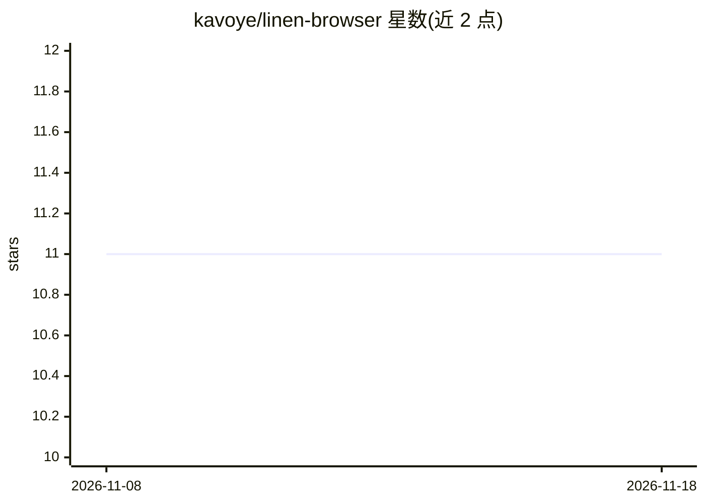

# kavoye/linen-browser

⭐ 11 · Swift · Apache-2.0 · 推送 2026-11-17 · [GitHub](https://github.com/kavoye/linen-browser) · 个人维护

**macOS 浏览器，内置可操作标签页的助手**

基于 WebKit/SwiftUI 的 macOS 浏览器，除标签页、空间、分屏、书签导入、自动填充、Chrome/Firefox 扩展安装等常规浏览功能外，内置助手可在打开的标签页中点击、输入、滚动，支持地址栏输入请求、按住 Shift 预览页面摘要、Agent Activity 查看操作记录。模型可选 Apple Intelligence 本地运行、接入 8 家提供商 API key 或本地 Ollama/LM Studio 服务器；提供 MCP server 供 Claude Code 等外部助手使用。助手权限按网站设置，API key 存于 Keychain。

## 筛选速览

| 维度 | 判定 | 备注 |
|---|---|---|
| AI 角色 | `ai-enhanced` | 去掉 AI 部分产品仍成立 |
| 许可风险 | `permissive` | Apache-2.0 |
| 部署形态 | `None` |  |
| 模型依赖 | local-ok | 支持本地模型 |
| 硬件要求 | — | 无带数字的原话,不猜 |
| 安装摩擦 | `low` | 无编译、无系统依赖或容器化 |
| 成熟度 | — | 结构信号不足 |

## 能力要点

- 助手可在已打开的标签页中点击、输入、滚动，点击页面即可中止接管
- 支持 Apple Intelligence 端侧运行及 OpenAI/Anthropic/DeepSeek 等 API key 接入
- 提供 MCP server 供 Claude Code 等外部助手使用
- 默认屏蔽已知第三方跟踪器，助手操作前请求确认且不能填充密码

## 适用场景

- 让助手搜索并阅读多个已打开的网页标签页
- 按住 Shift 快速预览链接页面摘要
- 在侧栏跟踪 GitHub 的 PR、检查与通知
- 通过 Chrome 网上应用店安装扩展的 macOS 浏览需求

## 场景标签

`浏览器自动化` `AI 助手` · 领域:效率与自动化

## 证据(README 行号)

> L5: A macOS browser with a built-in assistant.
> L68: Use Apple Intelligence on your Mac, add a provider API key, or connect to a local

## 星数曲线

2026-11-08 11 → 2026-11-18 11（+0）

---
*卡片 v1 · prompt 1.4 · 生成 2026-11-18 · 置信度 high · 依据 README sha `6d923bb33ebd` · [字段定义](../../DATASET.md)*
